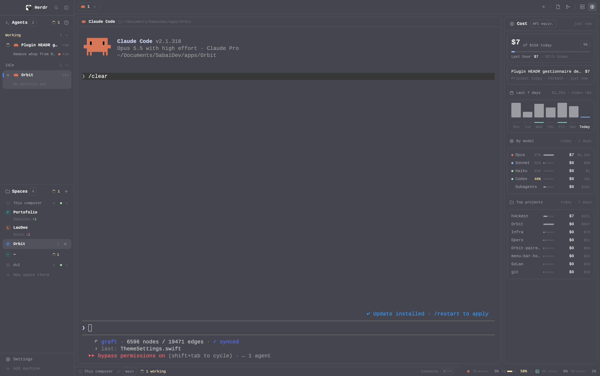
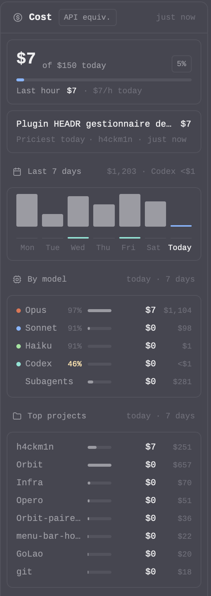
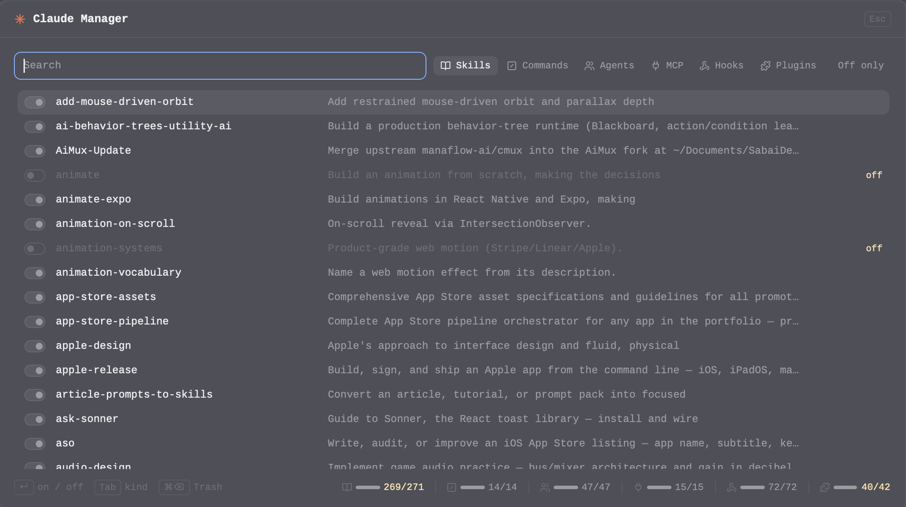
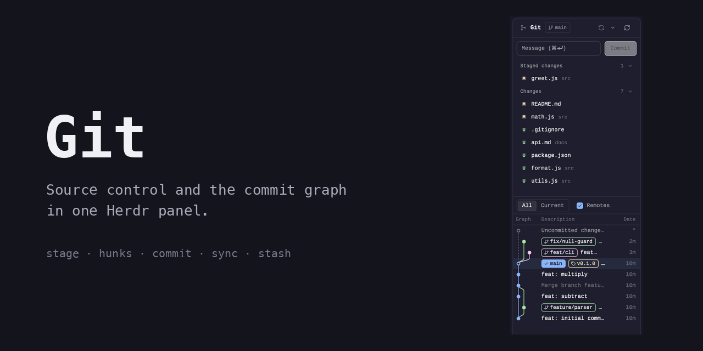
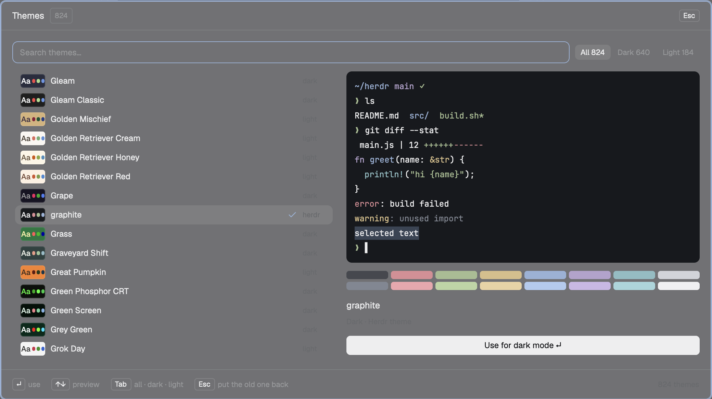
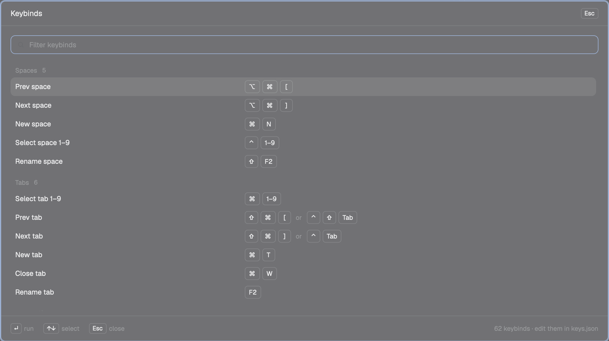

<div align="center">

# Crew for Herdr

**See every coding agent you run, in one calm window.**

A layout and mods for [Herdr](https://herdr.dev) that put your Claude Code and Codex agents first.
You see who is working, who needs you, what each one just did, what it costs, and how much of your
Claude and Codex quota is left, without switching tabs.



```sh
git clone https://github.com/h4ckm1n-dev/herdr-mods && cd herdr-mods && ./install.sh
```

Pick what you want from the list. You can try one mod or install the whole look.

</div>

---

## Crew · layout

The whole window, redrawn around agents. [Recipe](crew/RECIPE.md)

<table>
<tr>
<td width="30%" valign="top">


</td>
<td width="40%" valign="top">

### Agents first

- **Working, Needs you, Done, Idle.** A spinner while an agent works. Each row shows the agent's last action, its context fill, and its running sub-agents with progress.
- **⌘J** jumps to the next agent waiting on you, in any space.
- **Codex too:** Codex sessions get their own rows and a 5h / 7d quota card.

### Spaces

- Stable colored avatars, worktrees nested under their repo, grouped by machine.
- **Pick a space's color** from its menu. Its agents carry the same color as a thin bar, so you see at a glance which project an agent belongs to.

### One style everywhere

Tab bar, pane headers, menus, the New tab menu, worktree dialogs and the ⌘P tab picker all share
one small kit: theme colors only, keycaps for shortcuts, spinners for live work, no gradients. It
works in any Herdr theme, light or dark.

</td>
<td width="30%" valign="top">



### Cost panel · ⌘⇧U

What your Claude Code and Codex sessions would cost at API prices: today against a daily budget,
the last hour and your pace, the priciest session, 7 days as columns, by model with cache share,
sub-agents, and your top projects.

</td>
</tr>
</table>

### The bottom bar


Where you are and who is working on the left. On the right, your Claude Code and Codex 5h and 7d
quotas side by side. The gauges stay grey until 50%, then turn amber, and red past 90%.

## Mods that work in any layout

<table>
<tr>
<td width="50%" valign="top">



### [Claude Manager](claude-manager/RECIPE.md) · mod

**⌘⇧K**: every Claude Code skill, command, agent, MCP server, hook and plugin in `~/.claude`, on or
off with a click. It writes Claude Code's own settings, so turning an item back on leaves the file as it was. ⌘⌫ twice
moves a skill or an agent to the Trash.

</td>
<td width="50%" valign="top">



### [Git](git/RECIPE.md) · mod

VS Code's Source Control view and a commit graph in one panel. Stage files or single hunks, commit
with ⌘⏎, pull and push, switch branches, stash. Every destructive action asks first. Open a folder
that holds several repos and it lists them all with their sync state.

</td>
</tr>
<tr>
<td width="50%" valign="top">



### [Theme Gallery](theme-gallery/RECIPE.md) · mod

**⌘⇧T**: Herdr's themes plus the whole Ghostty collection (800+). Arrow keys recolor the whole app
live, Enter keeps the theme, Esc puts your old one back. A preview card shows light themes even while
you're in dark mode.

</td>
<td width="50%" valign="top">



### [Keybinds](help-crew/RECIPE.md) · mod

**⌘/**: every Herdr shortcut on one 16:9 sheet, drawn as real keycaps (`⌥` `⌘` `[`) and written in
plain words ("Delete word", not `\u0017`). Type to filter.

</td>
</tr>
</table>

## Install

```sh
./install.sh                          # choose from a numbered list
./install.sh git claude-manager       # just these
./install.sh --all                    # everything, with the Crew layout
./install.sh --list                   # what's available
```

**What the installer does:**
- Copies each mod into `~/.config/herdr-app/mods/` (or `$HERDR_APP_HOME`) and checks each one with `herdr-app check`.
- Merges the keybinds. It **asks before rebinding a key you already use**, and keeps your key if you say no or don't answer.
- **Backs up whatever it replaces** to `~/.config/herdr-app/backup/<time>/`.
- When a mod belongs to the Crew layout, offers that layout and brings the mods it needs. Pick **crew** in Settings › Layout.

**Update:** `git pull && ./install.sh`. Mods that haven't changed are left as they are.

Prefer the Herdr way? Ask the agent inside Herdr to add a folder, for example
`add https://github.com/h4ckm1n-dev/herdr-mods/tree/main/git`.

<details>
<summary><b>Why copy, not symlink?</b></summary>

Herdr reloads mods live, but only for files inside its own home folder: its file watcher ignores
paths outside it. A symlinked mod loads, then never updates while you edit it.

</details>

## Keys

| Key | What it does | From |
|---|---|---|
| <kbd>⌘</kbd><kbd>J</kbd> | Next agent waiting on you | Crew |
| <kbd>⌘</kbd><kbd>P</kbd> | Go to a tab | Crew |
| <kbd>⌘</kbd><kbd>E</kbd> · <kbd>⌘</kbd><kbd>G</kbd> · <kbd>⌘</kbd><kbd>⇧</kbd><kbd>U</kbd> | Files · Git · Cost panel | Crew |
| <kbd>⌘</kbd><kbd>⇧</kbd><kbd>A</kbd> · <kbd>⌘</kbd><kbd>⇧</kbd><kbd>S</kbd> | Keyboard to Agents · Spaces | Crew |
| <kbd>⌘</kbd><kbd>⇧</kbd><kbd>K</kbd> | Claude Manager | Claude Manager |
| <kbd>⌘</kbd><kbd>⇧</kbd><kbd>T</kbd> | Theme Gallery | Theme Gallery |
| <kbd>⌘</kbd><kbd>/</kbd> | Every keybind | Keybinds |

## Safe by design

- **Local only.** Nothing here calls a server. Agent rows, spend and quotas come from files already on your disk: your Claude Code transcripts (`~/.claude/projects`), the usage cache your Claude Code statusline writes, and the session logs Codex keeps in `~/.codex/sessions`.
- **No surprise git.** The Git panel won't automatically read a repo whose own config can launch a program: filter drivers, ssh, credential or askpass helpers, upload-pack and similar settings. Such a repo shows as *not read* until you open it. Fetch never prompts for credentials and never runs auto-gc.
- **Your Claude config, reversibly.** Claude Manager only uses Claude Code's own switches in `~/.claude/settings.json` (`skillOverrides`, `permissions.deny`, `deniedMcpServers`, `enabledPlugins`, `disableAllHooks`). Each write is atomic and backed up. A single hook, which has no native switch, is set aside in a side file and put back in place. Deleting moves files to the Trash, after a second ⌘⌫.
- **Asks first.** Discard, drop, abort, reset and Trash each ask for confirmation, and the installer asks before changing your keys.

## Needs

- The Herdr desktop app and `python3`. The Git mod also needs `git`.
- For the agent rows, Cost and the quota bar: Claude Code and/or Codex. Claude's quota meters need a Claude Code statusline that caches usage to `/tmp/claude/statusline-usage-cache.json`; Codex's come from its own session logs.
- Claude Manager's Trash uses macOS `/usr/bin/trash`.

## Rebuild it, remix it

Every folder has a `RECIPE.md`: a precise brief another agent can build the mod from in an empty
folder. It covers sizes, colors, behavior, the gotchas, and the checks that prove a build works. Fork
a recipe, change one line, and ask your agent to build your own version.

## Contributing

Issues and PRs welcome. Keep a change to one mod, run `herdr-app check` on it, and update its
`RECIPE.md` when what you see or how it behaves changes.

---

<div align="center">

If Crew makes your agents easier to follow, a ⭐ helps other Herdr users find it.

MIT · made by [h4ckm1n-dev](https://github.com/h4ckm1n-dev) · not affiliated with Herdr

</div>
