<div align="center">


# OhMyHerdr

**Turn the [Herdr](https://herdr.dev) desktop app into a cockpit for Claude Code and Codex.**<br>
See every agent at once, jump to the one waiting on you, and know what today costs before the bill does.

<p>
<a href="https://github.com/Kai-Finds"></a>
<a href="LICENSE"></a>


</p>

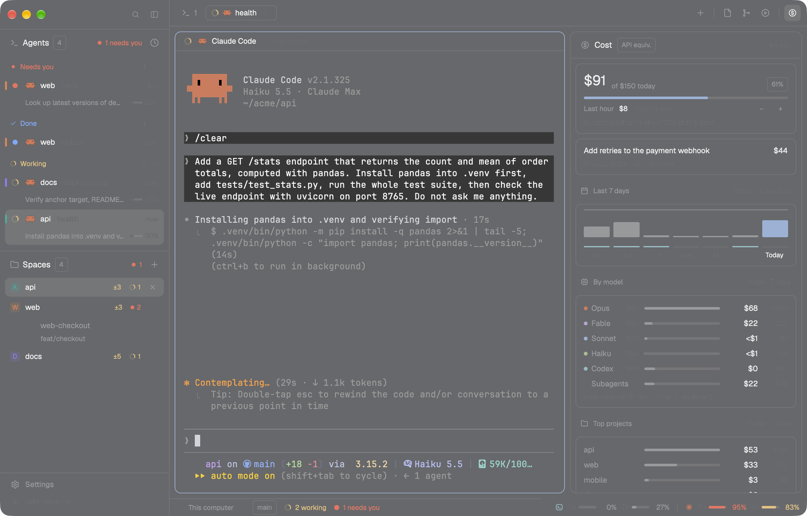

```sh
git clone https://github.com/Kai-Finds/OhMyHerdr && cd OhMyHerdr && ./install.sh --all
```

<sub>One layout · 25 mods · one installer · MIT · nothing leaves your machine but what you ask `gh` for</sub>

<p>
<a href="#worth-it-or-skip-it">Worth it?</a> ·
<a href="#whats-new">What's new</a> ·
<a href="#the-tour">Tour</a> ·
<a href="#install">Install</a> ·
<a href="#every-key">Keys</a> ·
<a href="#configure">Configure</a> ·
<a href="#requirements">Requirements</a> ·
<a href="#troubleshooting">Troubleshooting</a> ·
<a href="#under-the-hood">Under the hood</a>
</p>

</div>

<br>

## The problem

Run several agents in plain terminals and the same three things break.
OhMyHerdr fixes each one, in the window you already work in.

| Without OhMyHerdr | With OhMyHerdr |
|---|---|
| An agent sits on a question for twenty minutes because its tab was out of sight. | **Needs you** sits at the top of the sidebar, in red, across every space. <kbd>⌘</kbd><kbd>J</kbd> takes you straight to it. |
| You learn what a day of agents cost when the invoice lands. | The **Cost** panel prices every Claude Code and Codex session live: today, the last hour, 7 days, by model and by project. |
| The 5-hour quota runs out halfway through a refactor. | The Codex and Claude **5h and 7d quotas** sit in the bottom bar: grey until 50%, amber after, red past 90%. |

<a id="worth-it-or-skip-it"></a>


**✅ Worth it if**
- you run Claude Code and Codex side by side in the Herdr desktop app
- you want the day's spend and your 5h / 7d quotas in sight, not in an invoice
- you like keyboard-first panels: every panel and list has its own key

**❌ Skip it if**
- you don't use Herdr: every piece here is a Herdr mod
- your agents run inside tmux: they may not report their status to Herdr
- you want Claude quotas without a Pro or Max plan: Claude Code only exposes them on those plans

<br>

## What's new

**[Find files](fuzzy-files/)**: **⌘⇧F** searches filenames and paths in the
active tab's folder with fuzzy matching, the matched letters lit and each file
with its Files-panel icon. Enter opens the selection in a new Neovim tab in the
same space, and `:q` closes that tab. PNG and JPEG open in an image tab instead.
Install with `./install.sh fuzzy-files`.

**[Session recap](session-recap/)**: **⌘⇧H** shows which files a Claude Code
session read and wrote, on a timeline grouped by folder. Right-click an agent in
Crew to open its session; finished sessions work too.
Install with `./install.sh session-recap`.

**[OhMyHerdr Mods](mod-manager/)**: press **⌘⇧M** for a centered dialog to
switch installed mods on or off, live. A mod turned off keeps its files; Crew
mods fall back to Herdr's built-in equivalents when available.
Install it with `./install.sh mod-manager`.

**Images in a tab**: from Files or Find files, a PNG or JPEG opens in a Herdr
tab drawn with kitty graphics, centered and never upscaled. `:q`, `q` or Esc
closes the tab. JPEG goes through macOS `sips`.

<table>
<tr>
<td width="34%" valign="top" align="center">
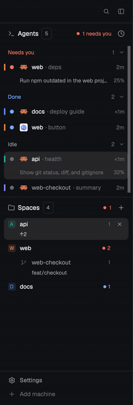
</td>
<td valign="top">

### Fold Agents or Spaces with one click

Click the **Agents** or **Spaces** header to fold that list down to its header. It eases shut in
about 200 ms and the other list takes the room. Agents folds up, Spaces folds down.

- Each list keeps its own state. With Spaces folded, folding Agents leaves Spaces folded, and each
  header stays at its own edge of the sidebar.
- A split you dragged between the two lists comes back when you open the list again.
- The state is part of the layout, so it is still there the next time you open Herdr.
- The buttons in a header (sort, new space) keep working: only the title area folds.

### And also

- **File icons in Files.** Every file and folder gets its Material Icon Theme icon, with light
  variants and open folders.
- **Claude quotas for everyone.** The installer can wrap your Claude Code statusline so the bottom
  bar gets your 5h and 7d Claude quotas. Your statusline still shows. See [Claude quotas](#claude-quotas).
- **Codex plans like Claude todos.** Codex's `update_plan` steps show as the same task list,
  progress bar and completion count as Claude's todos.
- **Codex first in the quota bar,** and Codex sessions honour `CODEX_SESSIONS` and `CODEX_HOME`.
- **A quieter brand row:** just search and the sidebar toggle.

</td>
</tr>
</table>

<br>

## The tour

OhMyHerdr is two things. **[Crew](crew/)** is the window itself: one layout and 14 mods for the
sidebar, tab bar, pane headers, side panels, bottom bar, menus and dialogs. **Standalone
modules** ([Claude Manager](claude-manager/), [Git](git/), [Theme Gallery](theme-gallery/),
[Keybinds](help-crew/), [Find files](fuzzy-files/), [OhMyHerdr Mods](mod-manager/) and the
[centered dialogs](dialogs/)) work in Crew or in Herdr's default layout. [CI runs](ci-dash/)
comes with the Crew layout as a side panel; cybertron288's [filetree](filetree/) installs by hand.

### Agents

<table>
<tr>
<td width="36%" valign="top">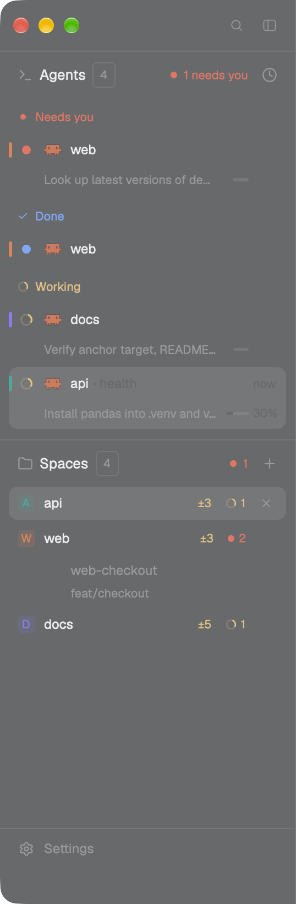</td>
<td valign="top">

Every Claude Code and Codex session running in Herdr, in four groups:

| Group | Looks like | Means |
|---|---|---|
| **Needs you** | red dot | the agent is waiting on your answer |
| **Working** | spinner | the agent is busy |
| **Done** | blue dot | it finished while you weren't looking |
| **Idle** | grey dot | nothing going on |

- A row shows the agent's icon (Claude in coral, Codex in its own colour), its space, the tab name
  and the time since its last state change.
- Under it: the last thing it did and how much of its context it has used.
- **Expand a row** to see the session's task list, its completion count, an overall progress bar and
  its delegated sub-agents. Claude's todos and Codex's plans share these rows.
- A thin bar on the left edge carries the colour of the agent's space.
- **Click a row** to jump to that agent's terminal, in any space.
- **Sort** by priority (the four groups) or grouped by space, from the clock button. Press
  <kbd>p</kbd> to pin an agent to the top.
- <kbd>⌘</kbd><kbd>⇧</kbd><kbd>A</kbd> gives the list the keyboard:
  <kbd>↑</kbd><kbd>↓</kbd> move · <kbd>⏎</kbd> open · <kbd>Space</kbd> fold · <kbd>p</kbd> pin · <kbd>s</kbd> sort · <kbd>Esc</kbd> back to the terminal.

It reads the transcripts your agents already write: `~/.claude/projects` for Claude Code and
`~/.codex/sessions` for Codex.

</td>
</tr>
</table>

### Spaces

- Each space has a stable coloured avatar. A row shows the space's name and agent count, then the
  repository's branch and how far it is ahead (↑) or behind (↓) its upstream.
- **Worktrees sit nested under their checkout**, with their branch (`web-checkout · feat/checkout`
  in the screenshot above).
- With more than one machine, spaces are grouped by machine, each with a **New space there** row.
- **Space colours:** right-click a space and pick one of 8 swatches. Its avatar and its agents'
  bars take that colour everywhere.
- <kbd>⌘</kbd><kbd>⇧</kbd><kbd>S</kbd> gives the list the keyboard:
  <kbd>↑</kbd><kbd>↓</kbd> move · <kbd>⏎</kbd> open · <kbd>n</kbd> new space · <kbd>m</kbd> menu · <kbd>Esc</kbd> back.

### Side panels: Files, Git, Cost

The three buttons at the right of the tab bar open one side panel each. The panel is 368 px wide
(drag its edge between 280 and 900). The same key closes it again.

<table>
<tr>
<td width="33%" valign="top" align="center">
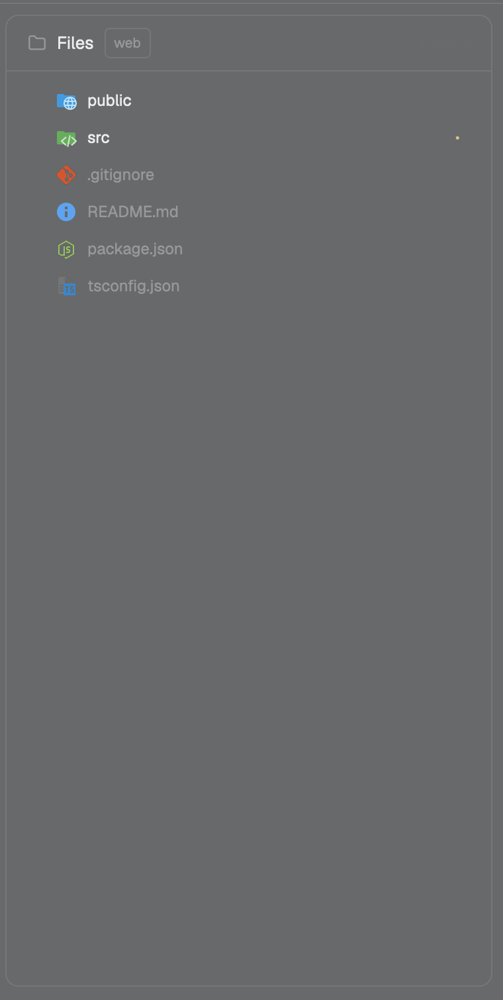
<h4>Files <kbd>⌘E</kbd></h4>
</td>
<td width="33%" valign="top" align="center">
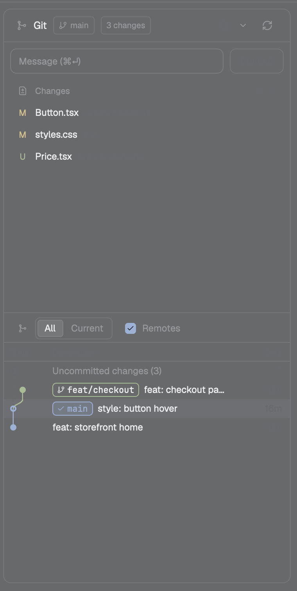
<h4>Git <kbd>⌘G</kbd></h4>
</td>
<td width="33%" valign="top" align="center">
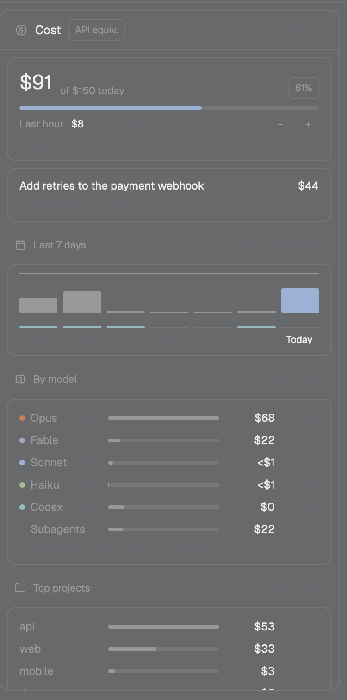
<h4>Cost <kbd>⌘⇧U</kbd></h4>
</td>
</tr>
<tr>
<td valign="top">

The focused terminal's folder as a lazy tree. It follows the terminal you are in.

- Material Icon Theme icons for files and folders.
- <kbd>Space</kbd> previews a file read-only.
- <kbd>⏎</kbd> opens it in this project's Neovim, in its own tab. A second file goes to the same
  Neovim.
- <kbd>←</kbd><kbd>→</kbd> fold and unfold folders.

</td>
<td valign="top">

Source Control and a commit graph in one panel.

- Stage files or single hunks, commit with <kbd>⌘</kbd><kbd>⏎</kbd>.
- One-button sync: fast-forward pull, then push.
- Branches, stash, rebase and merge conflicts.
- A folder of repos becomes a list of repos.
- Every branch and remote as coloured lanes.

The full guide is in **[git/](git/)**.

</td>
<td valign="top">

What your sessions would cost at API prices.

- **Today** against a daily budget, the last hour and your hourly pace.
- **Priciest today:** the session, with its sub-agents, that cost the most.
- **Last 7 days**, with Codex as a thin row.
- **By model**, with how much input came from cache.
- Sub-agents' share and **top projects**.

</td>
</tr>
</table>

### Bottom bar and quotas

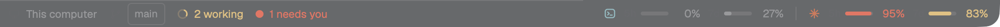

- **Left:** the machine, the branch, `n working` with a spinner, and `n needs you`.
- **Right:** your Codex and Claude Code **5h and 7d quotas** side by side. Grey until 50%, amber
  after, red past 90%. Hover one for the time until it resets.
- A window past its reset time shows as empty again, and a quota you don't have stays hidden.

### Go to anything <kbd>⌘P</kbd>

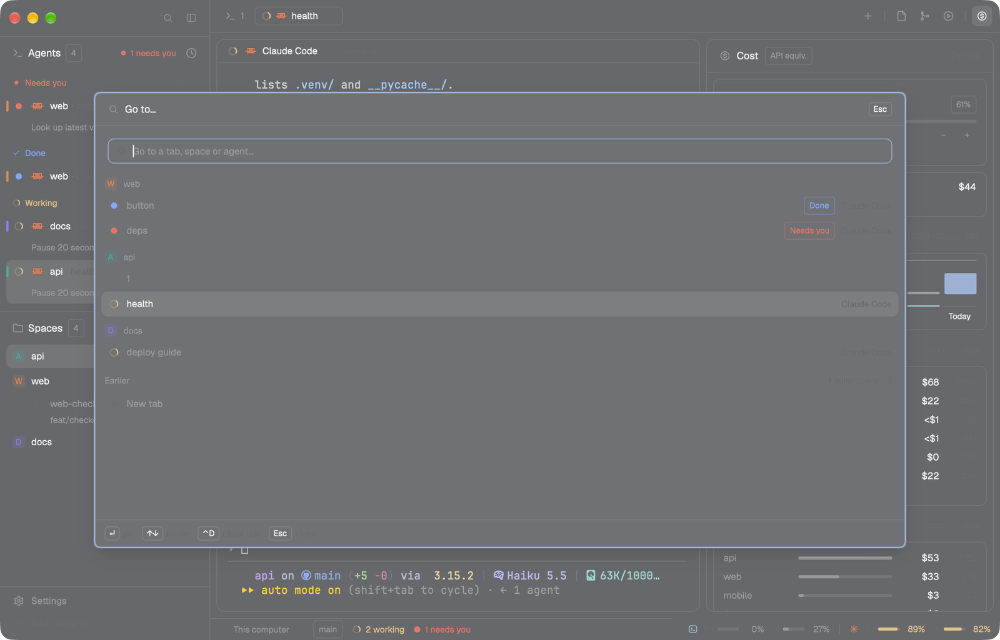

Type to jump to any tab, space or agent. Spaces that need you come first.

### Menus and dialogs

| Mod | What it draws |
|---|---|
| `menu-crew` | The tab, space and terminal context menus, with the space colour swatches |
| `new-menu-crew` | The **+** menu: a new terminal, or any agent you have installed |
| `worktree-crew` | New, open and remove worktree dialogs |
| `picker-crew` | <kbd>⌘</kbd><kbd>P</kbd>, go to a tab, space or agent |

They share one look: a 42 px header with an <kbd>Esc</kbd> keycap, 30 px items, and shortcuts drawn
as keycaps.

### Claude Manager <kbd>⌘⇧K</kbd>

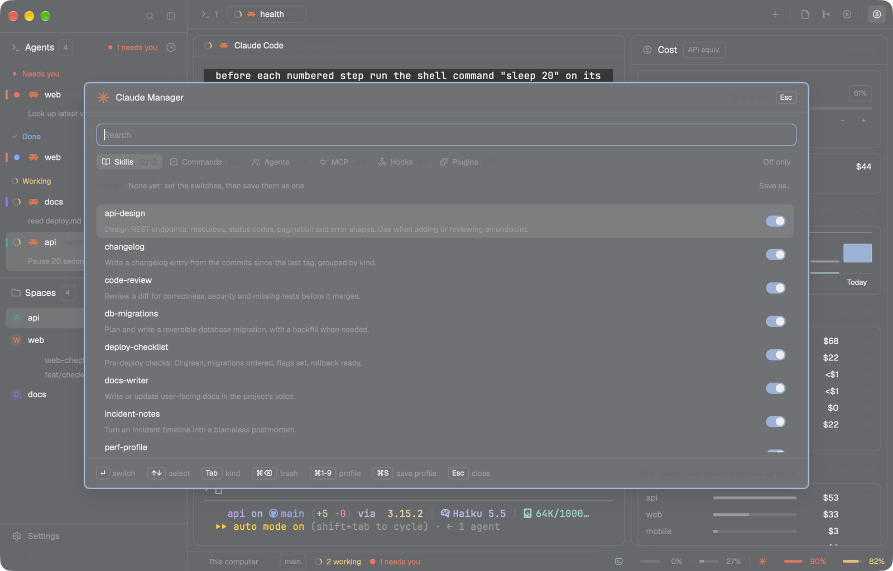

Every Claude Code **skill, command, agent, MCP server, hook and plugin** in one searchable list.

- Turn any of them off with a click, and back on: the file returns byte for byte to what it was.
- It writes only Claude Code's own switches (`skillOverrides`, `permissions.deny`, `enabledPlugins`
  and the like), atomically and with a backup.
- <kbd>⌘</kbd><kbd>⌫</kbd> twice moves a skill or agent to the Trash.

The full guide is in **[claude-manager/](claude-manager/)**.

### Theme Gallery <kbd>⌘⇧T</kbd>

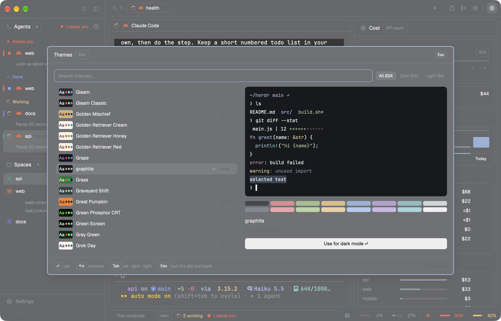

Herdr's themes plus every Ghostty theme on your machine: 824 here. Arrow through them and the
whole app repaints as you go. Filter by dark or light, and pick one theme for dark mode and another
for light. See **[theme-gallery/](theme-gallery/)**.

### Keybinds <kbd>⌘/</kbd>

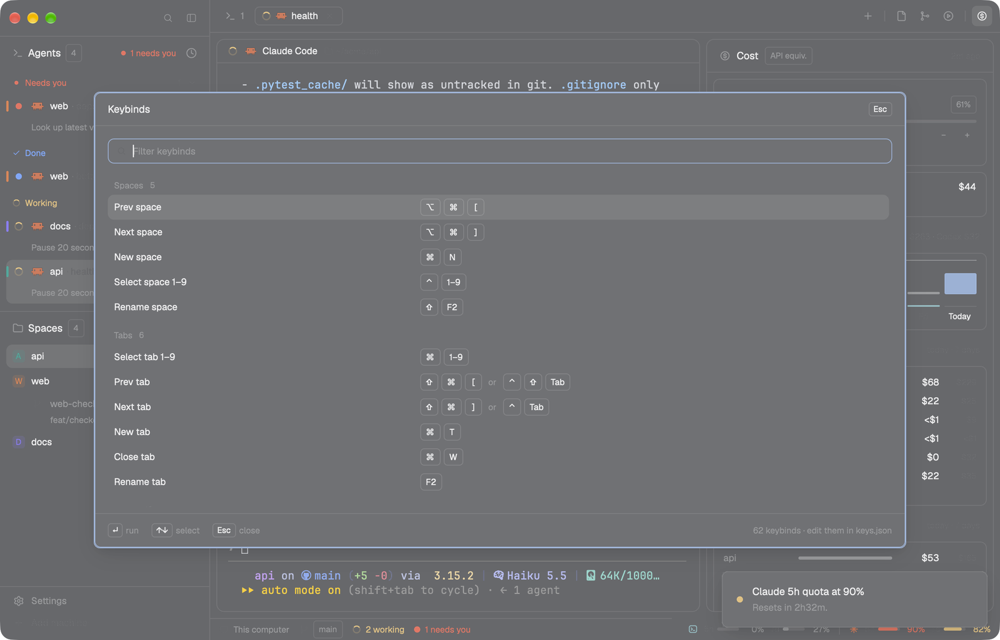

Every Herdr shortcut on one sheet, one line per action, drawn as keycaps. Type to filter,
<kbd>↑</kbd><kbd>↓</kbd> to move, <kbd>↵</kbd> or a click to run the action.
See **[help-crew/](help-crew/)**.

<br>

## Install

```sh
git clone https://github.com/Kai-Finds/OhMyHerdr && cd OhMyHerdr
./install.sh --all                    # everything but the opt-in dialogs, with the Crew layout
```

`--all` leaves out the [centered dialogs](dialogs/): they replace Herdr's own Settings,
command palette, Add machine and prompt with copies of Herdr 0.1.13, so they're opt-in.
Add them by name: `./install.sh settings-crew palette-crew machine-add-crew prompt-crew`.

**Upgrading from the first release:** `--all` used to install those dialogs. To give Herdr its
own screens back, delete `settings-crew`, `palette-crew`, `machine-add-crew` and `prompt-crew`
from `~/.config/herdr-app/mods/` and the `cmd-,` / `cmd-shift-p` lines from `keys.json`. If
claude-usage was off in OhMyHerdr Mods, turn it on and off once so your statusline works again.

Then pick **OhMyHerdr** in **Settings › Layout** (its card shows a preview).

**Window opacity and blur:** these require native Herdr changes. To build the
patched app on your own Mac, run `./native/window-opacity/build.sh`.
See [build instructions and requirements](native/window-opacity/README.md).
The builder also installs OhMyHerdr's mods and the Crew layout through the
existing installer; replacing the installed app bundle remains a manual step.

| Command | What it does |
|---|---|
| `./install.sh` | Pick from a numbered list |
| `./install.sh git claude-manager` | Install just these |
| `./install.sh --all` | Everything but the opt-in dialogs, with the Crew layout |
| `./install.sh --update` | Update what you already installed, nothing new |
| `./install.sh --list` | What's available |
| `-y` | Answer yes to every question |

The installer:

1. copies each mod into `~/.config/herdr-app/mods/` (or `$HERDR_APP_HOME/mods/`);
2. offers the Crew layout, and the mods it needs, when you pick one of its parts;
3. merges the keybinds, and **asks before rebinding a key you already use**;
4. offers to wire [Claude quotas](#claude-quotas) into your Claude Code statusline;
5. **backs up whatever it replaces** to `~/.config/herdr-app/backup/<time>/`;
6. checks every mod it installed with `herdr-app check`, and exits non-zero when one fails.

**Update:** `git pull && ./install.sh --update`. Only the mods you already have are touched, and those that
haven't changed are left alone. A mod you turned off in OhMyHerdr Mods is skipped: turn it on, then update.

**Remove:** delete the mod's folder from `~/.config/herdr-app/mods/`, or restore it from `backup/`.
If you remove `claude-usage` after wiring Claude quotas, put back the `settings.json.bak-<time>` the
installer left next to your Claude settings.

**The Herdr way:** ask the agent inside Herdr to add a folder, for example
`add https://github.com/Kai-Finds/OhMyHerdr/tree/main/git`.

<details>
<summary><b>Why copy, not symlink?</b></summary>
<br>

Herdr reloads mods live, but only for files inside its own home folder: its file watcher ignores
paths outside it. A symlinked mod loads, then never updates while you edit it.

</details>

### Claude quotas

Claude Code hands its 5h and 7d rate limits (Pro and Max plans) only to its **statusline** command.
To get them into the bottom bar, the installer offers to wrap the statusline you already have:

```jsonc
// ~/.claude/settings.json, before
"statusLine": { "type": "command", "command": "~/.claude/statusline.sh" }
// after
"statusLine": { "type": "command", "command": "python3 -I ~/.config/herdr-app/mods/claude-usage/statusline.py '~/.claude/statusline.sh'" }
```

The wrapper saves the quotas to `/tmp/claude/statusline-usage-cache.json`, then runs your command
with the same input, so your statusline looks exactly as before.

- It only asks when you already have a statusline, and only changes the file on a yes (or `-y`).
- It keeps a `settings.json.bak-<time>` copy, and edits the real file behind a symlink.
- Running the installer again doesn't wrap it twice.
- No statusline yet? Set the `after` line above by hand, without the quoted command.

Codex needs nothing: its quotas come from its own session logs.

<br>

## Every key

| Key | What it does | Where |
|---|---|---|
| <kbd>⌘</kbd><kbd>J</kbd> | Next agent waiting on you, in any space | everywhere |
| <kbd>⌘</kbd><kbd>P</kbd> | Go to a tab, space or agent | everywhere |
| <kbd>⌘</kbd><kbd>⇧</kbd><kbd>F</kbd> | Find files in the active tab's folder | everywhere |
| <kbd>⌘</kbd><kbd>⇧</kbd><kbd>H</kbd> | Session recap: the files a session read and wrote | everywhere |
| <kbd>⌘</kbd><kbd>⇧</kbd><kbd>M</kbd> | OhMyHerdr Mods: switch mods on or off | everywhere |
| <kbd>⌘</kbd><kbd>,</kbd> · <kbd>⌘</kbd><kbd>⇧</kbd><kbd>P</kbd> | Herdr's Settings · command palette, as centered dialogs | everywhere |
| <kbd>⌘</kbd><kbd>E</kbd> · <kbd>⌘</kbd><kbd>G</kbd> · <kbd>⌘</kbd><kbd>⇧</kbd><kbd>C</kbd> · <kbd>⌘</kbd><kbd>⇧</kbd><kbd>U</kbd> | Files · Git · CI runs · Cost panel (again: close) | Crew layout |
| <kbd>⌘</kbd><kbd>⇧</kbd><kbd>A</kbd> · <kbd>⌘</kbd><kbd>⇧</kbd><kbd>S</kbd> | Keyboard to Agents · Spaces | Crew layout |
| Click a header | Fold or open Agents · Spaces | Crew layout |
| <kbd>⌘</kbd><kbd>⇧</kbd><kbd>K</kbd> | Claude Manager | everywhere |
| <kbd>⌘</kbd><kbd>⇧</kbd><kbd>T</kbd> | Theme Gallery | everywhere |
| <kbd>⌘</kbd><kbd>/</kbd> | Every keybind | everywhere |

Crew's panel and sidebar keys live in the `layout:OhMyHerdr` section of `~/.config/herdr-app/keys.json`,
so they only apply while the Crew layout shows. Change any of them there.

<br>

## Configure

| What | Where | Default |
|---|---|---|
| Daily budget in the Cost panel | the **−** / **+** beside it in the panel ($10 steps), or <kbd>-</kbd> <kbd>+</kbd> with the panel focused. A toast warns at 80% and 100% | $150 |
| Sidebar width | drag its edge, or the brand row's toggle for a 44 px rail | 268 px |
| Side panel width | drag its edge | 368 px (280 to 900) |
| Agents and Spaces split | drag the line between them; click a header to fold | half each |
| Agent sort order | the clock button in the Agents header, or <kbd>s</kbd> | Priority |
| Space colours | right-click a space | from its name |
| Codex sessions folder | `CODEX_SESSIONS`, else `$CODEX_HOME/sessions` | `~/.codex/sessions` |
| Claude Code's folder | `CLAUDE_CONFIG_DIR`. Herdr opened from the Dock doesn't see variables your shell exports: start it from a terminal (`herdr-app`) for these three to apply | `~/.claude` |
| Colours | any Herdr theme: every piece uses theme colours only | your theme |

A file you change inside `~/.config/herdr-app/mods/` is replaced by the next `./install.sh`, and the
old one is kept in `backup/`.

<br>

## Requirements

| | Herdr app | `python3` | `git` | Claude Code / Codex | Other |
|---|:-:|:-:|:-:|:-:|---|
| Crew | ✓ | ✓ | for the Git panel | for agents, Cost, quotas | Neovim, to edit files from the Files panel; macOS `sips` for JPEG |
| Find files | ✓ | ✓ | to respect Git ignore rules | | Neovim; Crew's Files panel for file icons; macOS `sips` for JPEG |
| Session recap | ✓ | ✓ | | ✓ | |
| OhMyHerdr Mods | ✓ | ✓ | | | |
| Centered dialogs | ✓ | | | | opt-in, not in `--all`: copies of Herdr 0.1.13's own screens, may lag a newer Herdr |
| CI runs | ✓ | | | | GitHub CLI, logged in (`gh auth login`) |
| filetree | ✓ | | for git state | | cybertron288's file-icons mod |
| Claude Manager | ✓ | ✓ | | Claude Code | `/usr/bin/trash` (recent macOS) for Move to Trash |
| Git | ✓ | | ✓ | | |
| Theme Gallery | ✓ | ✓ | | | Ghostty, cmux or AiMux for the extra themes |
| Keybinds | ✓ | | | | |

Claude quotas need a Claude Pro or Max plan. Every Python script uses the standard library only.

<br>

## Safe by design

- **Local only.** Nothing here calls a server, except the CI runs panel, which asks GitHub through
  your own `gh` login. Everything else is read from files already on your disk.
- **No surprise git.** The Git panel won't read a repo whose own config can launch a program
  (filter drivers, ssh, credential or askpass helpers, upload-pack and similar) until you open it.
  Fetch never prompts for credentials and never runs auto-gc.
- **Your Claude config, reversibly.** Claude Manager writes only Claude Code's own switches,
  atomically and with a backup. The installer asks before touching your statusline, and keeps a copy.
- **Asks first.** Discard, drop, abort, reset and Trash each ask for confirmation, and the installer
  asks before changing your keys.

<br>

## Troubleshooting

<details>
<summary><b>The Crew mods don't show up</b></summary>
<br>

Pick **OhMyHerdr** in **Settings › Layout**. The `*-crew` mods only appear inside that layout, and a
missing mod leaves an empty block: install them together with `./install.sh --all`.
Then `herdr-app status` lists any error from a file or a mod.

</details>

<details>
<summary><b>No agents in the list</b></summary>
<br>

Agents show up once they report their status to Herdr, so start Claude Code or Codex in a Herdr
terminal. Older versions, and agents running inside tmux, may not report it.

</details>

<details>
<summary><b>The Claude quotas are missing from the bottom bar</b></summary>
<br>

They need a Pro or Max plan and the statusline wrapper (see [Claude quotas](#claude-quotas)).
Check that `/tmp/claude/statusline-usage-cache.json` exists after Claude Code has drawn its
statusline once.

</details>

<details>
<summary><b>Clicking a file in Files does nothing useful</b></summary>
<br>

Editing opens Neovim (`nvim`), which must be on your PATH. Previews (<kbd>Space</kbd>) work without it.

</details>

<details>
<summary><b>A list is folded and I can't open it</b></summary>
<br>

Click its header again. If the sidebar is on its narrow rail, expand the sidebar first: the rail
has no headers to click.

</details>

<br>

## Under the hood

<details>
<summary><b>How the modules fit together</b></summary>
<br>

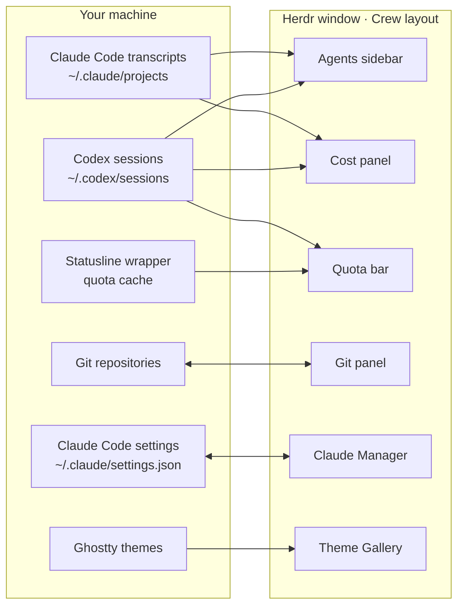

- **One source of truth, already on your disk.** No module keeps its own database. Agent rows and
  spend come from the transcripts Claude Code and Codex already write; quotas from what Claude Code
  hands its statusline and the limits Codex logs; switches straight from Claude Code's settings file.
- **Small Python readers, native UI.** Stdlib Python scripts run with `python3 -I` (`scan.py`,
  `codex_scan.py`, `cost.py`, `limits.py`, `statusline.py`, `manage.py`) print JSON, and the mods
  draw it with Herdr's native GPU UI.
- **The layout is the state.** Folding a list is a `layout.resize` of its block, eased over a dozen
  frames. An empty, hidden `sidebar-gap` block between the lists only shows when both are folded,
  so each header keeps its edge.
- **Modules talk through Herdr's shared state, never through each other's code:**

  | Key | Written by | Read by | Means |
  |---|---|---|---|
  | `space.colors` | space menu, spaces, picker | spaces, agents, menu, picker | the colour you picked for a space |
  | `crew.panel-focus` | tab bar (⌘E, ⌘G, ⌘⇧U) | every side panel | "this panel should take the keyboard" |
  | `sidebar.width`, `sidebar.collapsed` | agents, brand row | agents, brand row | the sidebar's size and rail mode |
  | `sidebar.fold.*`, `sidebar.folding` | agents, spaces | agents, spaces | a folded list's split, one fold at a time |
  | `agents.sort` | agents | agents | the agents list's sort order |
  | `git-graph.*` | Git | Git | columns, depth, tags, last fetch, "repo changed" |

- **One design kit.** Every module copies the same `kit.js`: theme colours only, a 4 px rhythm,
  42 px headers, keycaps for shortcuts, spinners only for live work, coral only for a live Claude,
  no gradients. It follows any Herdr theme, light or dark.

</details>

<details>
<summary><b>What's in this repository</b></summary>
<br>

```
OhMyHerdr/
├── README.md            this page
├── install.sh           the installer (runs install.py)
├── mods.tsv             the catalogue the installer lists
├── docs/                images for this page
├── crew/                the Crew layout and its 14 mods
├── claude-manager/      README.md · RECIPE.md · keys.json · mods/claude-manager
├── git/                 README.md · RECIPE.md · docs/ · mods/git
├── theme-gallery/       README.md · RECIPE.md · keys.json · mods/theme-gallery
├── help-crew/           README.md · RECIPE.md · keys.json · mods/help-crew
├── fuzzy-files/         Find files: README.md · keys.json · mods/fuzzy-files
├── session-recap/       Session recap: README.md · keys.json · mods/session-recap
├── mod-manager/         OhMyHerdr Mods: README.md · keys.json · mods/mod-manager
├── dialogs/             Herdr's Settings, palette, Add machine and prompt as centered dialogs
├── ci-dash/             GitHub Actions runs panel (a Crew side panel, needs `gh`)
├── filetree/            a file tree panel for any layout (manual install)
└── native/              patch to build Herdr with window opacity and blur
```

Every module folder is one entry on herdr.dev: a **README** for the people who use it, and a
**RECIPE** for the agent that builds it. A recipe is a brief precise enough for another agent to
rebuild the module in an empty folder: sizes, colours, behaviour, the gotchas, and the checks that
prove a build works. Fork a recipe, change one line, and ask your agent to build your own version.

</details>

<br>

## Contributing

Issues and PRs are welcome. Keep a change to one module, run `herdr-app check` on each mod you
touched, run its tests if it has some (`python3 -I tests/test_*.py`), and update its README and
RECIPE when what you see or how it behaves changes. `kit.js` is the same file in every mod: change
one copy, then copy it to the others.

<br>

<div align="center">

Bookmark this one. A ⭐ also helps other Herdr users find it.

<sub>MIT © 2026 <a href="https://github.com/h4ckm1n-dev">h4ckm1n-dev</a>, except <code>dialogs/</code> and <code>native/</code> (Apache-2.0, derived from Herdr) · the Git module builds on <a href="https://github.com/rabeeh-ta/herdr-git-graph">herdr-git-graph</a> by Rabeeh T A · file icons from <a href="https://github.com/cybertron288/herdr-mods">cybertron288/herdr-mods</a> and Material Icon Theme · line icons from Lucide · window opacity from <a href="https://github.com/herdrdev/herdr-app/pull/1007">herdr-app #1007</a>, built on cunderw's <a href="https://github.com/herdrdev/herdr-app/pull/191">#191</a> · screenshots use demo projects · not affiliated with Herdr</sub>

</div>


<div align="center">

<a href="https://www.threads.com/@kaifinds.ai"></a>

</div>

---

<div align="center">

<sub><b>Kai Finds</b> · Do more with AI · The AI tools that turn one person into a team.<br>
Sourced. No hype. Every claim here points to something you can check.<br>
<a href="https://kaifinds.sabaidev.la">kaifinds.sabaidev.la</a> · <a href="https://www.threads.com/@kaifinds.ai">Threads</a> · <a href="https://www.facebook.com/122105394627540019">Facebook</a> · <a href="https://github.com/Kai-Finds">All repos</a></sub>

</div>
