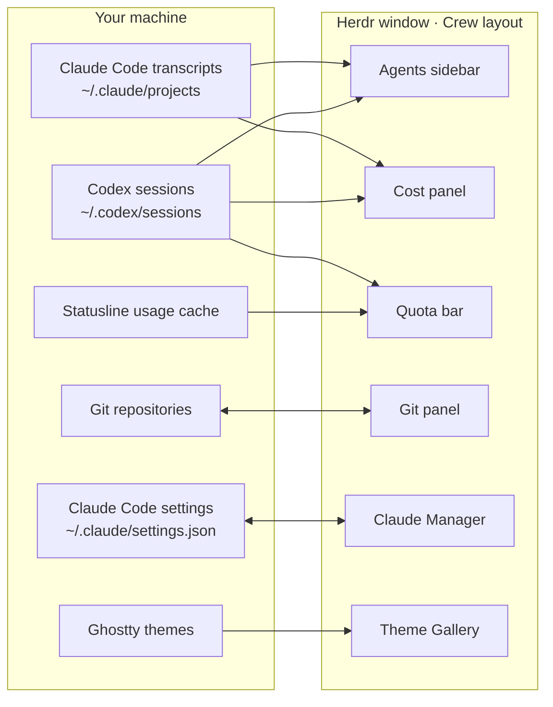

<div align="center">

# Crew for Herdr

**A cockpit for the coding agents you run: one calm window, every agent in sight.**

Crew is a set of modules for the [Herdr](https://herdr.dev) desktop app. Together they turn Herdr
into a control room for Claude Code and Codex: who is working, who needs you, what each agent just
did, what it costs, how much quota is left, and which skills, agents and MCP servers Claude Code
loads. Take the whole system, or one module at a time.


```sh
git clone https://github.com/h4ckm1n-dev/herdr-mods && cd herdr-mods && ./install.sh
```

</div>

---

## The modules

| Module | Kind | What it gives you | Key | Docs |
|---|---|---|---|---|
| **[Crew](crew/)** | layout + 13 mods | The window itself: agents and spaces sidebar, tab bar with side panels, Cost panel, quota bar, menus and dialogs in one style | ⌘J · ⌘P · ⌘⇧U | [README](crew/README.md) · [Recipe](crew/RECIPE.md) |
| **[Claude Manager](claude-manager/)** | mod (dialog) | Every Claude Code skill, command, agent, MCP server, hook and plugin, on or off with a click | ⌘⇧K | [README](claude-manager/README.md) · [Recipe](claude-manager/RECIPE.md) |
| **[Git](git/)** | mod (panel) | Source Control and a commit graph in one side panel: stage hunks, commit, sync, branches, stash | ⌘G | [README](git/README.md) · [Recipe](git/RECIPE.md) |
| **[Theme Gallery](theme-gallery/)** | mod (dialog) | Herdr's themes plus the whole Ghostty collection, previewed live on the whole app | ⌘⇧T | [README](theme-gallery/README.md) · [Recipe](theme-gallery/RECIPE.md) |
| **[Keybinds](help-crew/)** | mod (dialog) | Every Herdr shortcut on one sheet, drawn as keycaps, filterable | ⌘/ | [README](help-crew/README.md) · [Recipe](help-crew/RECIPE.md) |

Each module stands on its own. Crew is the only one that needs its layout; the four others work in
any Herdr layout, including the default one.

## How it fits together



- **One source of truth, already on your disk.** No module keeps its own database. Agent rows and
  spend are read from the transcripts Claude Code and Codex already write; quotas from the cache
  your statusline writes and the limits Codex logs; switches straight from Claude Code's own
  settings file.
- **Small Python readers, native UI.** The heavy reading is done by stdlib Python scripts run with
  `python3 -I` (`scan.py`, `codex_scan.py`, `cost.py`, `limits.py`, `manage.py`, `scan.py`). They
  print JSON, and the mods draw it with Herdr's native GPU UI.
- **Modules talk through Herdr's shared state, never through each other's code:**

  | Key | Written by | Read by | Means |
  |---|---|---|---|
  | `space.colors` | space menu, spaces, picker | spaces, agents, menu, picker | the color you picked for a space |
  | `crew.panel-focus` | tab bar (⌘E, ⌘G, ⌘⇧U) | every side panel | "this panel should take the keyboard" |
  | `sidebar.width`, `sidebar.collapsed` | agents, brand row | agents, brand row | the sidebar's size and rail mode |
  | `agents.sort` | agents | agents | the agents list's sort order |
  | `git-graph.*` | Git | Git | columns, depth, tags, last fetch, "repo changed" |

- **One design kit.** Every module copies the same `kit.js`: theme colors only, a 4px rhythm, 42px
  headers, keycaps for shortcuts, spinners only for live work, coral only for a live Claude, no
  gradients. It follows any Herdr theme, light or dark.

## Install

```sh
./install.sh                          # choose from a numbered list
./install.sh git claude-manager       # just these
./install.sh --all                    # everything, with the Crew layout
./install.sh --list                   # what's available
```

The installer:
- Copies each mod into `~/.config/herdr-app/mods/` (or `$HERDR_APP_HOME`) and checks each one with `herdr-app check`.
- Merges the keybinds, and **asks before rebinding a key you already use**. If you say no or don't answer, your key stays.
- **Backs up whatever it replaces** to `~/.config/herdr-app/backup/<time>/`.
- When a mod belongs to the Crew layout, offers that layout and the mods it needs. Then pick **crew** in Settings › Layout.

**Update:** `git pull && ./install.sh`. Mods that haven't changed are left alone.
**Remove:** delete the mod's folder from `~/.config/herdr-app/mods/`, or put back the copy in `backup/`.

Prefer the Herdr way? Ask the agent inside Herdr to add a folder, for example
`add https://github.com/h4ckm1n-dev/herdr-mods/tree/main/git`.

<details>
<summary><b>Why copy, not symlink?</b></summary>

Herdr reloads mods live, but only for files inside its own home folder: its file watcher ignores
paths outside it. A symlinked mod loads, then never updates while you edit it.

</details>

## Every key

| Key | What it does | Module |
|---|---|---|
| <kbd>⌘</kbd><kbd>J</kbd> | Next agent waiting on you, in any space | Crew |
| <kbd>⌘</kbd><kbd>P</kbd> | Go to a tab | Crew |
| <kbd>⌘</kbd><kbd>E</kbd> · <kbd>⌘</kbd><kbd>G</kbd> · <kbd>⌘</kbd><kbd>⇧</kbd><kbd>U</kbd> | Files · Git · Cost panel (again: close) | Crew |
| <kbd>⌘</kbd><kbd>⇧</kbd><kbd>A</kbd> · <kbd>⌘</kbd><kbd>⇧</kbd><kbd>S</kbd> | Keyboard to Agents · Spaces | Crew |
| <kbd>⌘</kbd><kbd>⇧</kbd><kbd>K</kbd> | Claude Manager | Claude Manager |
| <kbd>⌘</kbd><kbd>⇧</kbd><kbd>T</kbd> | Theme Gallery | Theme Gallery |
| <kbd>⌘</kbd><kbd>/</kbd> | Every keybind | Keybinds |

## Requirements

| | Herdr app | `python3` | `git` | Claude Code / Codex | Other |
|---|:-:|:-:|:-:|:-:|---|
| Crew | ✓ | ✓ | for the Git panel | for agents, Cost, quotas | a statusline that caches usage, for Claude's quota meters |
| Claude Manager | ✓ | ✓ | | Claude Code | macOS `/usr/bin/trash` for Move to Trash |
| Git | ✓ | | ✓ | | |
| Theme Gallery | ✓ | ✓ | | | Ghostty, cmux or AiMux for the extra themes |
| Keybinds | ✓ | | | | |

Claude's quota meters read `/tmp/claude/statusline-usage-cache.json`, which a Claude Code statusline
has to write. Codex's come from its own session logs, nothing to set up.

## Safe by design

- **Local only.** Nothing here calls a server. Everything is read from files already on your disk.
- **No surprise git.** The Git panel won't automatically read a repo whose own config can launch a program: filter drivers, ssh, credential or askpass helpers, upload-pack and similar settings. Such a repo shows as *not read* until you open it. Fetch never prompts for credentials and never runs auto-gc.
- **Your Claude config, reversibly.** Claude Manager writes only Claude Code's own switches, atomically and with a backup. Turning an item back on leaves the file byte for byte as it was. Deleting moves files to the Trash after a second ⌘⌫.
- **Asks first.** Discard, drop, abort, reset and Trash each ask for confirmation, and the installer asks before changing your keys.

## What's in this repository

```
herdr-mods/
├── README.md            you are here: the system
├── install.sh           the installer (runs install.py)
├── mods.tsv             the catalog the installer lists
├── crew/                the Crew layout and its 13 mods
│   ├── README.md · RECIPE.md · keys.json · preview.png
│   ├── layouts/crew.json
│   └── mods/            agents-crew, spaces-crew, tabs-crew, cost, claude-usage, …
├── claude-manager/      README.md · RECIPE.md · keys.json · mods/claude-manager
├── git/                 README.md · RECIPE.md · docs/ · mods/git
├── theme-gallery/       README.md · RECIPE.md · keys.json · mods/theme-gallery
└── help-crew/           README.md · RECIPE.md · keys.json · mods/help-crew
```

Every module folder is one entry on herdr.dev: a **README** for people who use it, and a
**RECIPE** for the agent that builds it. A recipe is a precise brief another agent can rebuild the
module from in an empty folder: sizes, colors, behavior, the gotchas, and the checks that prove a
build works. Fork a recipe, change one line, and ask your agent to build your own version.

## Contributing

Issues and PRs welcome. Keep a change to one module, run `herdr-app check` on each mod you touched,
run its tests if it has some (`tests/`), and update its README and RECIPE when what you see or how
it behaves changes.

---

<div align="center">

If Crew makes your agents easier to follow, a ⭐ helps other Herdr users find it.

MIT · made by [h4ckm1n-dev](https://github.com/h4ckm1n-dev) · not affiliated with Herdr

</div>
