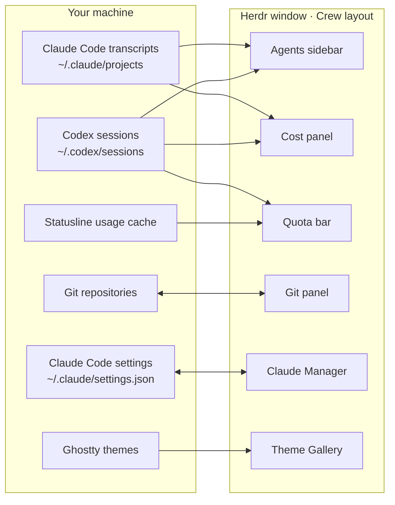

<div align="center">


<br>

**Crew turns the [Herdr](https://herdr.dev) desktop app into a cockpit for Claude Code and Codex.**<br>
See every agent at once, jump to the one waiting on you, and know what today costs before the bill does.

```sh
git clone https://github.com/h4ckm1n-dev/herdr-mods && cd herdr-mods && ./install.sh
```

<sub>Five modules, MIT, local only: nothing leaves your machine</sub>

</div>

<br>

## Why you want it

Running several agents in plain terminals goes wrong in the same three ways. Crew answers each one
in the window you already work in.

| Without Crew | With Crew |
|---|---|
| An agent sits on a question for twenty minutes because its tab was out of sight. | **Needs you** sits at the top of the sidebar, red, in every space. <kbd>⌘</kbd><kbd>J</kbd> takes you straight to it. |
| You learn what a day of agents cost when the invoice lands. | The **Cost** panel prices every Claude Code and Codex session live: today, last hour, 7 days, by model and project. |
| The 5-hour quota runs out halfway through a refactor. | Codex and Claude **5h and 7d quotas** sit in the bottom bar, grey until 50%, amber after, red past 90%. |

<br>

## What's in the box

**[Crew](crew/)** is the window itself: one layout and 13 mods for the sidebar, tab bar, pane
headers, side panels, bottom bar, menus and dialogs. The four modules below work on their own, in
Crew or in Herdr's default layout.

<table>
<tr>
<td width="50%" valign="top">
<a href="claude-manager/"></a>
<h3><a href="claude-manager/">Claude Manager</a> <kbd>⌘⇧K</kbd></h3>
Every Claude Code skill, command, agent, MCP server, hook and plugin in one list. Turn any of them
off with a click, and back on byte for byte.
</td>
<td width="50%" valign="top">
<a href="git/"></a>
<h3><a href="git/">Git</a> <kbd>⌘G</kbd></h3>
Source Control and a commit graph in one side panel. Stage files or single hunks, commit, sync,
switch branches and stash without leaving your terminal.
</td>
</tr>
<tr>
<td width="50%" valign="top">
<a href="theme-gallery/"></a>
<h3><a href="theme-gallery/">Theme Gallery</a> <kbd>⌘⇧T</kbd></h3>
Herdr's themes plus the whole Ghostty collection, 824 in all. Arrow through them and the whole
app repaints as you go.
</td>
<td width="50%" valign="top">
<a href="help-crew/"></a>
<h3><a href="help-crew/">Keybinds</a> <kbd>⌘/</kbd></h3>
Every Herdr shortcut on one sheet, grouped and drawn as keycaps. Type to filter.
</td>
</tr>
</table>

<br>

## Install

```sh
./install.sh                          # pick from a numbered list
./install.sh git claude-manager       # just these
./install.sh --all                    # everything, with the Crew layout
./install.sh --list                   # what's available
```

Then pick **crew** in Settings › Layout. The installer:

- copies each mod into `~/.config/herdr-app/mods/` (or `$HERDR_APP_HOME`) and checks it with `herdr-app check`;
- merges the keybinds, and **asks before rebinding a key you already use**;
- **backs up whatever it replaces** to `~/.config/herdr-app/backup/<time>/`;
- offers the Crew layout, and the mods it needs, when you pick one of its parts.

**Update:** `git pull && ./install.sh`. Unchanged mods are left alone.
**Remove:** delete the mod's folder from `~/.config/herdr-app/mods/`, or restore it from `backup/`.

Prefer the Herdr way? Ask the agent inside Herdr to add a folder, for example
`add https://github.com/h4ckm1n-dev/herdr-mods/tree/main/git`.

<details>
<summary><b>Why copy, not symlink?</b></summary>
<br>

Herdr reloads mods live, but only for files inside its own home folder: its file watcher ignores
paths outside it. A symlinked mod loads, then never updates while you edit it.

</details>

## Every key

| Key | What it does | Module |
|---|---|---|
| <kbd>⌘</kbd><kbd>J</kbd> | Next agent waiting on you, in any space | Crew |
| <kbd>⌘</kbd><kbd>P</kbd> | Go to a tab, space or agent | Crew |
| <kbd>⌘</kbd><kbd>E</kbd> · <kbd>⌘</kbd><kbd>G</kbd> · <kbd>⌘</kbd><kbd>⇧</kbd><kbd>U</kbd> | Files, Git, Cost panel (again: close) | Crew |
| <kbd>⌘</kbd><kbd>⇧</kbd><kbd>A</kbd> · <kbd>⌘</kbd><kbd>⇧</kbd><kbd>S</kbd> | Keyboard to Agents, Spaces | Crew |
| <kbd>⌘</kbd><kbd>⇧</kbd><kbd>K</kbd> | Claude Manager | Claude Manager |
| <kbd>⌘</kbd><kbd>⇧</kbd><kbd>T</kbd> | Theme Gallery | Theme Gallery |
| <kbd>⌘</kbd><kbd>/</kbd> | Every keybind | Keybinds |

## Safe by design

- **Local only.** Nothing here calls a server. Everything is read from files already on your disk.
- **No surprise git.** The Git panel won't read a repo whose own config can launch a program (filter drivers, ssh, credential or askpass helpers, upload-pack and similar) until you open it. Fetch never prompts for credentials and never runs auto-gc.
- **Your Claude config, reversibly.** Claude Manager writes only Claude Code's own switches, atomically and with a backup. Turning an item back on leaves the file byte for byte as it was. Deleting moves files to the Trash, after a second <kbd>⌘</kbd><kbd>⌫</kbd>.
- **Asks first.** Discard, drop, abort, reset and Trash each ask for confirmation, and the installer asks before changing your keys.

## Requirements

| | Herdr app | `python3` | `git` | Claude Code / Codex | Other |
|---|:-:|:-:|:-:|:-:|---|
| Crew | ✓ | ✓ | for the Git panel | for agents, Cost, quotas | a statusline that caches usage, for Claude's quota meters |
| Claude Manager | ✓ | ✓ | | Claude Code | macOS `/usr/bin/trash` for Move to Trash |
| Git | ✓ | | ✓ | | |
| Theme Gallery | ✓ | ✓ | | | Ghostty, cmux or AiMux for the extra themes |
| Keybinds | ✓ | | | | |

Claude's quota meters read `/tmp/claude/statusline-usage-cache.json`, which a Claude Code statusline
has to write. Codex's come from its own session logs, nothing to set up.

## Under the hood

<details>
<summary><b>How the modules fit together</b></summary>
<br>



- **One source of truth, already on your disk.** No module keeps its own database. Agent rows and
  spend come from the transcripts Claude Code and Codex already write; quotas from the cache your
  statusline writes and the limits Codex logs; switches straight from Claude Code's settings file.
- **Small Python readers, native UI.** Stdlib Python scripts run with `python3 -I` (`scan.py`,
  `codex_scan.py`, `cost.py`, `limits.py`, `manage.py`) print JSON, and the mods draw it with
  Herdr's native GPU UI.
- **Modules talk through Herdr's shared state, never through each other's code:**

  | Key | Written by | Read by | Means |
  |---|---|---|---|
  | `space.colors` | space menu, spaces, picker | spaces, agents, menu, picker | the color you picked for a space |
  | `crew.panel-focus` | tab bar (⌘E, ⌘G, ⌘⇧U) | every side panel | "this panel should take the keyboard" |
  | `sidebar.width`, `sidebar.collapsed` | agents, brand row | agents, brand row | the sidebar's size and rail mode |
  | `agents.sort` | agents | agents | the agents list's sort order |
  | `git-graph.*` | Git | Git | columns, depth, tags, last fetch, "repo changed" |

- **One design kit.** Every module copies the same `kit.js`: theme colors only, a 4px rhythm, 42px
  headers, keycaps for shortcuts, spinners only for live work, coral only for a live Claude, no
  gradients. It follows any Herdr theme, light or dark.

</details>

<details>
<summary><b>What's in this repository</b></summary>
<br>

```
herdr-mods/
├── README.md            the system (this page)
├── install.sh           the installer (runs install.py)
├── mods.tsv             the catalog the installer lists
├── docs/                images for this page
├── crew/                the Crew layout and its 13 mods
├── claude-manager/      README.md · RECIPE.md · keys.json · mods/claude-manager
├── git/                 README.md · RECIPE.md · docs/ · mods/git
├── theme-gallery/       README.md · RECIPE.md · keys.json · mods/theme-gallery
└── help-crew/           README.md · RECIPE.md · keys.json · mods/help-crew
```

Every module folder is one entry on herdr.dev: a **README** for the people who use it, and a
**RECIPE** for the agent that builds it. A recipe is a brief precise enough for another agent to
rebuild the module in an empty folder: sizes, colors, behavior, the gotchas, and the checks that
prove a build works. Fork a recipe, change one line, and ask your agent to build your own version.

</details>

## Contributing

Issues and PRs welcome. Keep a change to one module, run `herdr-app check` on each mod you touched,
run its tests if it has some (`tests/`), and update its README and RECIPE when what you see or how
it behaves changes.

<br>

<div align="center">

If Crew keeps your agents in sight, a ⭐ helps other Herdr users find it.

<sub>MIT © 2026 <a href="https://github.com/h4ckm1n-dev">h4ckm1n-dev</a> · the Git module builds on <a href="https://github.com/rabeeh-ta/herdr-git-graph">herdr-git-graph</a> by Rabeeh T A · not affiliated with Herdr</sub>

</div>
