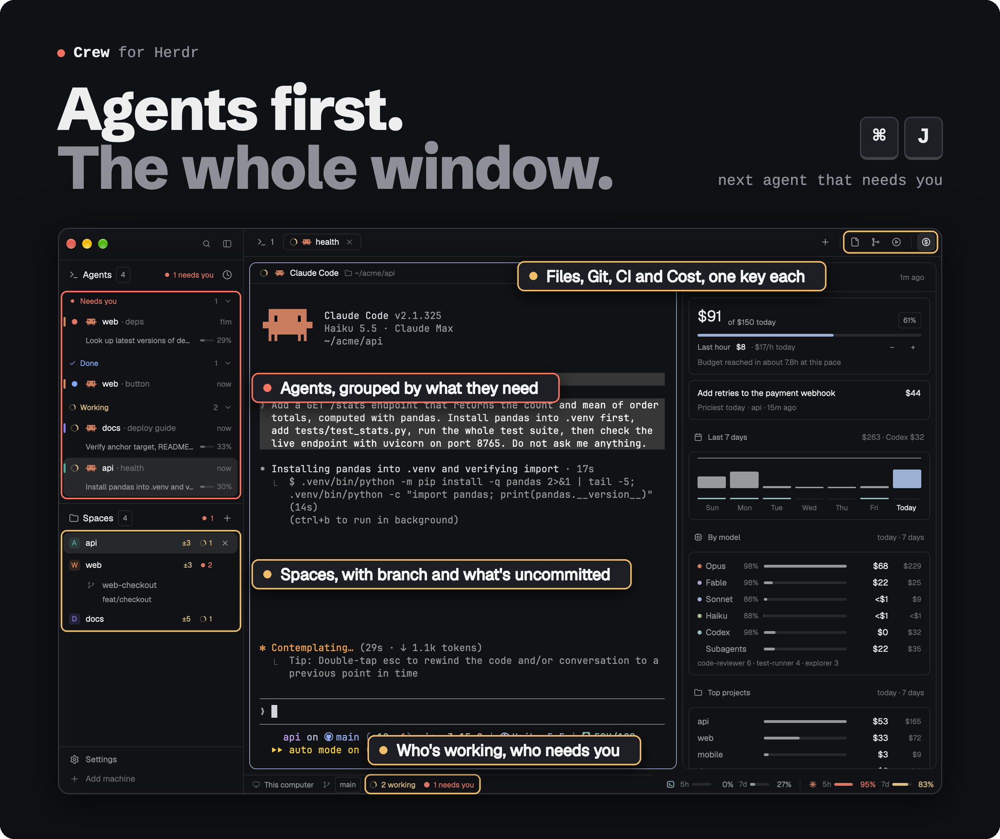
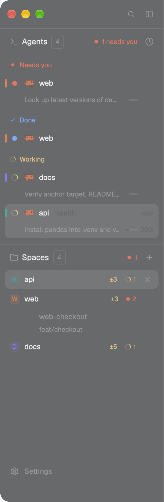
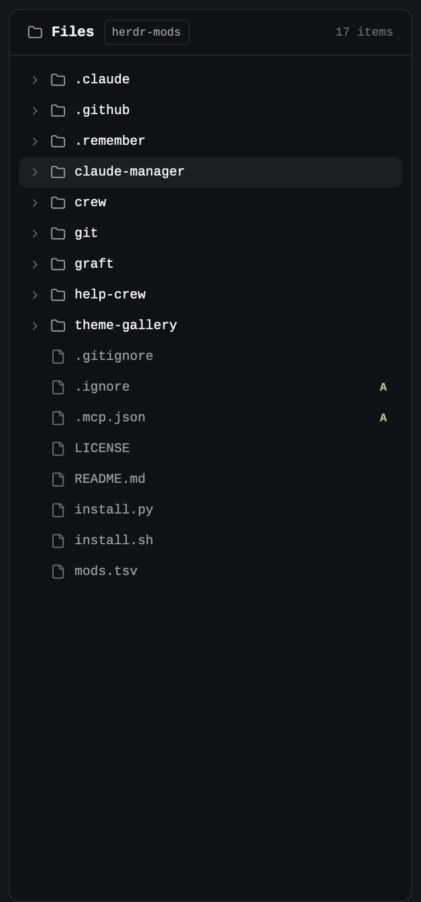
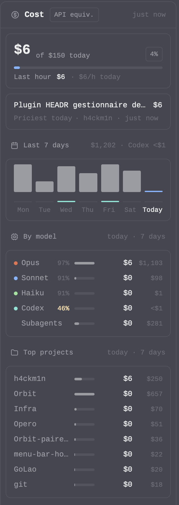
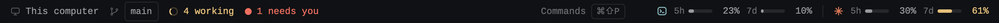
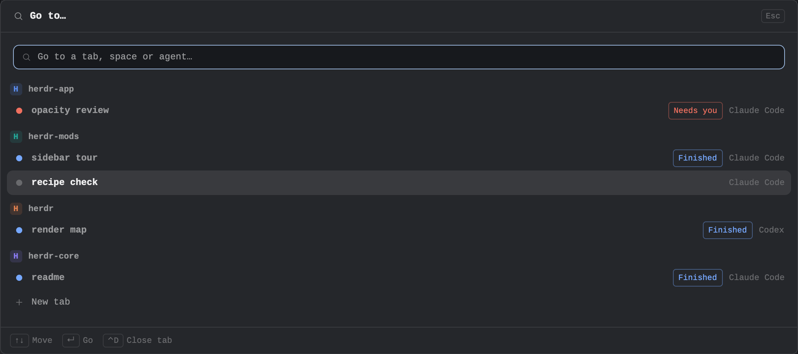

<div align="center">



<br>

**One layout and 14 mods that rebuild the Herdr window around your coding agents.**<br>
Agents and spaces on the left, Files, Git and Cost on the right, quotas along the bottom. Each piece also works alone.

```sh
./install.sh --all
```

<a href="https://github.com/Kai-Finds"></a>

<sub><a href="../README.md">All modules</a> · <a href="RECIPE.md">Recipe, to rebuild it with your agent</a></sub>

</div>

## The window, region by region

```
┌──────────────┬────────────────────────────────────────────┬──────────────┐
│ brand row    │ tab bar  · tabs · + · [Files] [Git] [Cost] │              │
├──────────────┼────────────────────────────────────────────┤              │
│ Agents       │ pane header                                │  side panel  │
│  Working     │                                            │  Files       │
│  Needs you   │            your terminals                  │  Git         │
│  Done · Idle │                                            │  Cost        │
├──────────────┤                                            │              │
│ Spaces       │                                            │              │
├──────────────┼────────────────────────────────────────────┴──────────────┤
│ footer       │ bottom bar · machine · branch · n working   quotas 5h · 7d │
└──────────────┴───────────────────────────────────────────────────────────┘
```

| Region | Mod | Size |
|---|---|---|
| Brand row, sidebar footer | `workspace-chrome-crew` | 46px · 69px |
| Agents | `agents-crew` | half the sidebar |
| Spaces | `spaces-crew` | the other half |
| Tab bar | `tabs-crew` | 42px |
| Pane headers | `pane-crew` | 30px |
| Side panel stack | `files-crew` · `git` · `cost` | 368px, 280 to 900, resizable |
| Bottom bar | `workspace-status-crew` · `claude-usage` | 28px |
| Menus and dialogs | `menu-crew` · `new-menu-crew` · `worktree-crew` · `picker-crew` | overlays |

The sidebar is 268px. Drag its edge, or use the brand row's toggle, to fold it to a 44px rail.
Click the **Agents** or **Spaces** header to fold that list to its header (Agents up, Spaces down); the other
list takes the room. Both folded, each header stays at its own edge.

## Components

### Agents · `agents-crew`



Every Claude Code and Codex session, in four groups: **Working**, **Needs you**, **Done** and
**Idle**.

- Right-click an agent to see the files its session read and wrote ([Session recap](../session-recap/), when installed).
- A row shows a spinner while the agent works, its icon (Claude in coral, Codex in cyan), its name,
  and the time since its last state change.
- Under it: the last activity and context percentage. Expand the row for the session's task
  list, completion count, overall progress bar, and delegated agents. Claude's todos and
  Codex's `update_plan` use the same rows; tasks appear only when recorded by the agent.
- A thin bar on the left edge carries the color of the agent's space.
- Click a row to jump to that agent's terminal, in any space. **⌘⇧A** gives the list the keyboard
  (arrows, Enter).

It reads your own transcripts on disk with `scan.py` and `codex_scan.py`: `~/.claude/projects` and
`~/.codex/sessions`.

### Spaces · `spaces-crew`

- Each space has a stable colored avatar. Two lines per row: the name and its agent count, then the
  repo, the branch and ↑↓ against its upstream.
- Worktrees sit nested under their checkout. Spaces are grouped by machine when you have more than
  one, with a **New space there** row.
- **Space colors:** right-click a space and pick one of 8 swatches. Its avatar and its agents' bars
  take that color everywhere.
- **⌘⇧S** gives the list the keyboard.

<br clear="right">

### Brand row and footer · `workspace-chrome-crew`

Search and the sidebar toggle at the top. Settings and Add machine at the bottom.
The brand row drags the window.

### Tab bar · `tabs-crew`

- Your tabs, a **+** that opens the New tab or agent menu, and one button per side panel on the right: Files, Git, Cost.
- **⌘E**, **⌘G** and **⌘⇧U** open those panels and give them the keyboard. The same key again closes the panel.
- **⌘J** jumps to the next agent waiting on you, in any space.

### Pane headers · `pane-crew`

A 30px header on each pane: the program's icon and name, the title, the folder, then split, zoom
and close.

### Files · `files-crew`



The focused pane's folder as a lazy tree, with read-only previews. It follows the terminal you are in.
File and folder icons use Material Icon Theme, including light variants and open folders.
The icons and lookup tables are bundled from [file-icons](https://github.com/cybertron288/herdr-mods/tree/main/file-icons), with its MIT licence. Keyboard navigation, Neovim actions and previews stay in `files-crew`.


<br clear="right">

### Git · `git`

Source Control and a commit graph in one panel. It's also a module of its own: [Git](../git/README.md).

### Cost · `cost`



What your sessions would cost at API prices, from the same transcripts:

- **Today** against a daily budget, with the last hour and your hourly pace. The budget is
  `DAILY_BUDGET` at the top of `cost/main.js`, $150 by default.
- **Priciest today:** the session, with its sub-agents, that cost the most.
- **Last 7 days** as columns, Codex as a thin row under them.
- **By model**, with the share of input read from cache. Low means full-price re-reads.
- **Sub-agents'** share and **top projects**.

Codex is estimated at the configured API rates, even if you run it on a ChatGPT plan.
Automatic approval-review threads are excluded; delegated work remains included. `cost.py` does the
reading; the panel refreshes every minute while it is visible.

<br clear="right">

### Bottom bar · `workspace-status-crew` and `claude-usage`



- **Left:** the machine, the branch, `n working` with a spinner, and `n needs you`.
- **Right:** your Codex and Claude Code 5h and 7d quotas side by side. Grey until 50%, amber after, red past 90%, with the time to reset in the tooltip.

`limits.py` reads them every 30 seconds:
- **Claude:** from `/tmp/claude/statusline-usage-cache.json`, which `claude-usage/statusline.py` writes from
  what Claude Code hands its statusline. The installer wraps your statusline with it (yours still shows);
  by hand: `"command": "python3 -I ~/.config/herdr-app/mods/claude-usage/statusline.py '<your command>'"`.
- **Codex:** from the newest timestamped rate-limit report in five recently touched sessions.
  Session readers honor `CODEX_SESSIONS`, then `$CODEX_HOME/sessions`, then `~/.codex/sessions`.
  A missing quota window stays hidden.

With neither, the block stays empty.

### Menus and dialogs

| Mod | What it draws |
|---|---|
| `menu-crew` | The tab, space and terminal context menus, with the space color swatches |
| `new-menu-crew` | The **+** menu: a new terminal, or any agent you have installed |
| `worktree-crew` | New, open and remove worktree dialogs |
| `picker-crew` | **⌘P**, go to a tab: spaces that need you first, typing filters |



All share one look: `popover` background, a 42px header with an `Esc` keycap, 30px items, and
shortcuts drawn as keycaps.

## Agent states

| State | Looks like | Means |
|---|---|---|
| Working | spinner in the theme's `working` color | the agent is busy |
| Needs you | `blocked` dot, in the Needs you group | it is waiting on your answer |
| Done | `done` dot | it finished while you weren't looking |
| Idle | `dim` dot | nothing going on |

Coral is kept for a live Claude, so it always means "Claude is working right now".

<a id="worth-it-or-skip-it"></a>


**✅ Worth it if**
- you run several Claude Code or Codex sessions and want them sorted by what they need from you
- you want Files, Git and Cost one key away, and quotas always on screen

**❌ Skip it if**
- you prefer Herdr's default layout: the standalone modules work there too
- you don't run Claude Code or Codex: the agent rows, Cost and the quota bar stay empty

## Install

```sh
./install.sh --all        # the layout and every mod it needs
```

Then pick **OhMyHerdr** in Settings › Layout. Install all of its mods together: the layout names each
one, and a missing mod leaves an empty block.

## Keys

| Key | What it does |
|---|---|
| <kbd>⌘</kbd><kbd>J</kbd> | Next agent waiting on you |
| <kbd>⌘</kbd><kbd>P</kbd> | Go to a tab |
| <kbd>⌘</kbd><kbd>E</kbd> · <kbd>⌘</kbd><kbd>G</kbd> · <kbd>⌘</kbd><kbd>⇧</kbd><kbd>U</kbd> | Files · Git · Cost |
| <kbd>⌘</kbd><kbd>⇧</kbd><kbd>A</kbd> · <kbd>⌘</kbd><kbd>⇧</kbd><kbd>S</kbd> | Keyboard to Agents · Spaces |

The panel and sidebar keys live in the `layout:OhMyHerdr` section of `keys.json`, so they only apply
while the Crew layout shows. ⌘J and ⌘P are global.

## Customize

- **Daily budget:** `DAILY_BUDGET` in `cost/main.js`.
- **Colors:** Crew uses theme colors only. Change the theme (or try [Theme Gallery](../theme-gallery/README.md)) and every piece follows.
- **The design kit:** `kit.js` is the same in every mod. Change one copy, then copy it to the others, or the looks drift.

## Requirements

- The Herdr desktop app and `python3`.
- Claude Code and/or Codex for the agent rows, Cost and the quota bar.
- For Claude's quota meters: a Pro or Max plan, and the statusline wrapper the installer offers.
- Neovim, to edit files from the Files panel (previews work without it).
- `git` for the Git panel.

---

<sub><b>Kai Finds</b> · Do more with AI · <a href="https://github.com/Kai-Finds">github.com/Kai-Finds</a> · <a href="https://kaifinds.sabaidev.la">kaifinds.sabaidev.la</a></sub>
