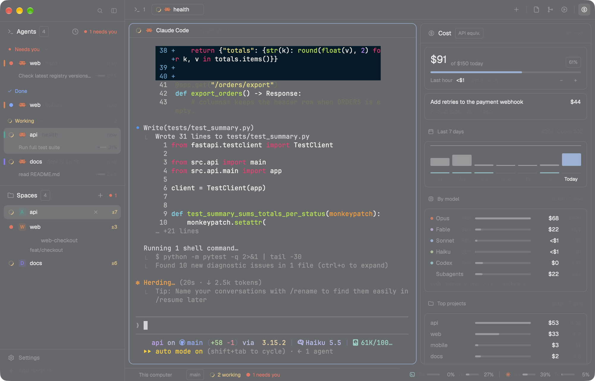

# Crew

A Herdr window built around your coding agents. A left sidebar shows every agent first, then your
spaces. A tab bar carries buttons for the side panels: files, a git graph and Claude Code spend. A
28px bottom bar shows where you are, who is working, and your Codex and Claude Code 5h / 7d quotas. Every piece is
drawn with one small kit: theme colors only, a 36px text indent, spinners for live work, and
keycaps for shortcuts.

## What you see

A row filling the window, with no system title bar (traffic lights at 12,16) on `canvas`:

1. **Sidebar**, 268px, `chrome`. It narrows to a 44px rail by dragging its edge or with the brand
   row's toggle.
   - **Brand row**, 46px, draggable: the Herdr mark, search, sidebar toggle.
   - **Agents**, half the remaining height: a 42px header with `Agents`, a count tag, a live
     `n working` and a sort button. Under it, groups (Needs you, Done, Working, Idle) of 36px rows.
     A row has a 16px status gutter (a spinner while working, 8px dots otherwise), the agent's
     icon in its color (Claude coral `#D97757`, Codex cyan), its name, and the time since its last
     state change. A Claude or Codex agent adds lines under its row: the last thing it did, its
     context fill as a 4px bar, and its running sub-agents with progress bars.
   - **Spaces**, the other half: stable colored avatars, worktrees nested under their checkout,
     grouped by machine when there is more than one, plus a `New space there` row.
   - **Footer**, 69px: Settings and Add machine.
2. **Work column**:
   - **Tab bar**, 42px, draggable. It holds the tabs, a `+` button (new tab or agent menu), and on
     the right one icon button per side panel: Files, Git, Cost, CI runs.
   - **Body**, 8px padding and gap: the terminal pane. Each pane has a 30px `pane-crew` header
     with the program, title, folder, and split / zoom / close buttons. A side panel column sits
     at the right, 368px (280–900, resizable). It is hidden until a tab-bar button opens it, and
     stacks the Files, Git, Cost and CI runs panels.
   - **Bottom bar**, 28px, `chrome`, 1px top border, 11px `muted` type:
     - On the left: a monitor or server icon with the machine, the branch as a tag, then
       `n working` with a spinner and `n needs you` with a `blocked` dot, or just `n agents`.
     - On the right, a 420px block of quotas, right-aligned: for each tool with data, `5h` and a
       28px bar with the percent, then `7d` the same. With one tool, the time to reset follows each
       percent. With Codex and Claude both, Codex first, each group starts with a 12px line glyph in the tool's color
       (a `>_` prompt in a rounded square in Codex cyan, an asterisk in Claude coral; the mod's own SVGs), a 1px separator between them, resets in the tooltips. The bars are `muted`
       grey, turn `working` amber at 50% and `blocked` red at 90%; percents sit in a fixed 28px column.
   - **Dialogs and menus** share one look: `popover` background, a 42px header with an `Esc`
     keycap, 30px menu items with shortcuts drawn as keycaps. This covers the tab and terminal
     context menus, the new tab menu, the worktree dialogs, and the ⌘P go-to-tab picker (16:9,
     1040×585). Dialog outlines use the theme accent color. Crew’s Settings and Add machine
     footer entries open `settings-crew` and `machine-add-crew` from the opt-in `dialogs` pack when
     they are installed and on, and Herdr’s own `app.settings` / `machine-add` otherwise.

## How it behaves

- Agent statuses: **working** shows a spinner in the theme's `working` color, **blocked** a
  `blocked` dot plus a Needs you group, **done** a `done` dot (a viewed done agent stays in Done
  until you leave it), **idle** a `dim` dot. Coral is only used for a live Claude.
- A space's menu offers 8 color swatches. The pick is stored in shared `space.colors`: the space's
  avatar takes it, and each of its agents gets a 3px bar in that color on the row's left edge.
- Clicking an agent focuses its terminal, in any space. ⌘J jumps to the next agent waiting on you.
- ⌘⇧A and ⌘⇧S give the keyboard to Agents and Spaces (arrows, Enter).
- ⌘E opens Files, ⌘G the git graph and ⌘⇧U Cost. The same key again closes the panel.
- ⌘P opens the tab picker: spaces with something that needs you first, typing filters.
- Right-clicking a tab, space or terminal opens the crew context menu.
- The quota block runs `limits.py` every 30s: Claude from the statusline cache, Codex from the newest
  `rate_limits` in `~/.codex/sessions` (a window past its reset reads 0). With neither, it is empty.
- The Cost panel fits without scrolling: today (Claude Code plus Codex at API prices; the split in the
  amount's tooltip, `· Codex $3` on the pace line once Codex spent 50¢) against the daily budget, then `Last hour $19 · $13/h
  today` (the last hour amber when it runs past 1.5x today's average per active hour); a card for the priciest
  session today (its title as Claude Code names it, its subagents included, its project, last active); the last 7 days as columns
  (Claude $ in grey, today in the accent; a thin cyan row of Codex under it when Codex was used, at
  OpenAI's API prices and on the same dollar scale; hover a column for its value); by model, each with its cache share
  (input read from cache, amber under 70%), a Codex row and a Subagents row and today's sub-agent runs; the top 8 projects.

## Built from

- `layouts/OhMyHerdr.json` (with `"preview": "layouts/OhMyHerdr.png"`, its Settings card): the root row, then the `sidebar` column with `brand` (workspace-chrome-crew),
  `sidebar-lists` (agents-crew, spaces-crew) and `sidebar-footer` (workspace-chrome-crew with
  `{footer: true}`). Next to it, the `work` column with `tabs` (tabs-crew) and `work-body`. The
  `work-body` row holds the terminal and a hidden `panel` stack: files-crew, git, cost. Below it,
  the `status-row` holds workspace-status-crew and claude-usage at 420px. Pane headers use
  pane-crew, and `terminal_menu` is menu-crew.
- Mods in `mods/`: agents-crew, spaces-crew, workspace-chrome-crew, tabs-crew,
  workspace-status-crew, claude-usage, pane-crew, files-crew, git, cost, menu-crew,
  new-menu-crew, worktree-crew, picker-crew. Each mod has its own copy of the Crew `kit.js`.
- Programs: `python3` scripts read Claude Code and Codex transcripts (agents-crew `scan.py`,
  `codex_scan.py`, cost `cost.py`). git runs `git`. claude-usage runs `limits.py`
  (reads `/tmp/claude/statusline-usage-cache.json` and `~/.codex/sessions`).
- Icons come from the shipped `mods/workspace-chrome/*.svg`.

## Watch out

- **Shared files:** agents-crew and cost read `~/.claude/projects` (your transcripts, local only).
  claude-usage only shows data if your Claude Code statusline writes the usage cache.
- **Install all the mods together:** the layout names every mod above, so a missing one leaves
  an empty block.
- **Keep the kit in sync:** keep one canonical `kit.js` and copy it into each mod, or the looks
  drift.
- **Drop typings:** `gpui-kit.d.ts` is editor typing only; leave it out of copies.
- **Ops slot:** tabs-crew shows an Ops button only when the layout has an `ops` block (none here).
- **CI slot:** tabs-crew shows a CI runs button beside Git when the layout has a `ci` block pointing to `ci-dash` with `panel: true` (install separately).
- **File icons:** files-crew bundles the `file-icons` mod's Material Icon Theme assets and generated lookup tables. Keep its MIT licence; use full-color images, light variants, open-folder icons and longest-extension matching. Preserve Crew's keyboard and Neovim actions.

## Done when

- `herdr-app check` passes for every mod in `mods/`, and `layout.switch {name: "OhMyHerdr"}` shows the
  sidebar, tab bar and bottom bar with no empty block.
- With a Claude agent working, its row shows a spinner and its context bar. The bottom bar reads
  `1 working`.
- ⌘G opens the git graph in the side panel, and ⌘G again closes it.
- `herdr-app shot` shows the bottom bar's 5h / 7d meters when the statusline cache exists.

### Codex reader checks

Session readers honor `CODEX_SESSIONS`, then `$CODEX_HOME/sessions`, then `~/.codex/sessions`
([OpenAI configuration](https://developers.openai.com/codex/config-advanced)).
Agent matching must never mark a subagent/approval-review rollout as an exact terminal match.
Subagent `MESSAGE` records refresh activity; only `FINAL_ANSWER` records mark completion.
Map Codex `update_plan` snapshots to the same `usage.todos` shape as Claude's todos, so
the shared renderer supplies the fold, counts, task glyphs and overall progress bar.
Keep plan updates out of the activity line. Recover plans before the 512KB tail within
the existing 8MB lookback; older plans beyond that bound are unavailable.
Use recorded tool titles/descriptions for readable activity labels, including CUA `js` calls.
Read model names from `turn_context` as well as `thread_settings_applied`, including before long tails.
Recognize textual and JSON exit codes. Exclude `guardian_review` sessions from estimated spend.
Quota selection uses report timestamps across five recently touched rollouts; missing windows stay hidden.

Run `python3 -I crew/mods/agents-crew/tests/test_codex.py`,
`python3 -I crew/mods/claude-usage/tests/test_limits.py`, and
`python3 -I crew/mods/cost/tests/test_cost.py` from the repository root.
