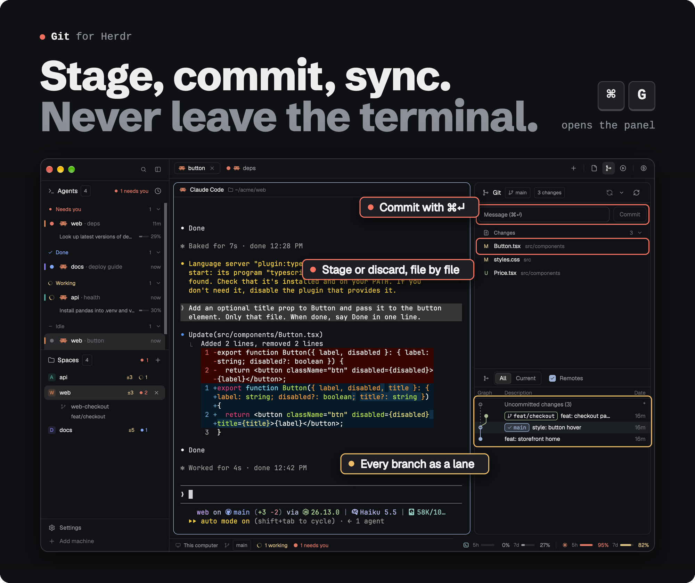

<div align="center">



<br>

**Your daily git loop in one side panel, with the commit graph underneath.**<br>
Stage files or single hunks, commit, pull and push, switch branches and stash, without leaving the terminal you're in.

```sh
./install.sh git
```

<a href="https://github.com/Kai-Finds"></a>

<sub><a href="../README.md">All modules</a> · <a href="RECIPE.md">Recipe, to rebuild it with your agent</a></sub>

</div>

## What it does

- **Changes and Staged groups.** Hover a file for discard (↺), stage (+) or unstage (−). Hover a
  group header for the same on every file. Click a header to fold it.
- **Commit** with ⌘⏎ in the message box. With nothing staged, it stages everything first.
- **Diffs with hunk buttons.** Click a file to see its diff in the bottom half, with
  Stage hunk / Discard hunk (or Unstage hunk) on each `@@` line. ↑/↓ step through files, Esc goes
  back to the graph.
- **Sync** in one button: fast-forward pull, then push. `↑2 ↓1` shows where you stand. With no
  upstream it becomes **Publish**. If the branch has diverged, it asks: rebase, merge or cancel.
- **Branches:** click the branch chip to filter, check out, or create one. A remote branch becomes a
  tracking branch.
- **Stash** from the menu (right-click the sync button), then apply, pop or drop any of the last 10.
- **Rebasing or merging?** Conflicted files show with `!`, and the header offers Continue and Abort.
- **A folder of repos** (Manygit): open a folder that holds several repositories and the panel
  lists them all with their sync state, plus **Fetch all**.
- **The graph:** every branch and remote as colored lanes, with tags. Drag the divider to resize,
  double-click it to reset.

## Safety

- **Every destructive action asks first:** discard (file, group or hunk), deleting untracked files,
  stash drop, mark resolved, abort. The confirm says when it can't be undone.
- **No surprise git in a folder of repos.** Before reading a repo it found, the panel reads only its
  config. A repo that could make git launch a program (filter drivers, ssh, credential or askpass
  helpers, upload-pack and similar) shows as *not read* until you click it. The repo you are working
  in is read like any git prompt there would read it.
- **Fetch, pull and push never prompt** for credentials. **Fetch all** also skips hooks, auto-gc and
  submodules.
- **If the branch moved** in a terminal since the panel drew, the action is refused rather than
  applied to the new HEAD.
- **No polling.** It reads git when the repo changes on disk, when you change focus, space or tab,
  and after its own actions.

<a id="worth-it-or-skip-it"></a>


**✅ Worth it if**
- your loop is stage, commit, sync, repeat, and you want it next to the terminal
- you keep a folder of repos and want their sync state in one list

**❌ Skip it if**
- you need line-level staging, amend, blame or file history: not built yet
- you resolve conflicts in a dedicated tool: here it stops at Continue and Abort

## Install

```sh
./install.sh git
```

- **In the Crew layout,** it is the Git panel (⌘G).
- **In another layout,** add a block next to your other side panels:

  ```json
  { "id": "graph", "type": "block", "content": { "mod": "git" } }
  ```

It replaces Herdr's Changes panel and the original Git Graph panel. The settings of the original
(columns, depth, tags) carry over.

## Requirements

The Herdr desktop app and `git`. It works on remote machines too, except the live folder watch: there,
it refreshes on focus changes and after its own actions.

## Not built (yet)

Line-level staging, conflict resolution beyond Continue/Abort, amend, blame, file history,
commit search.

## Credits

Forked from [rabeeh-ta/herdr-git-graph](https://github.com/rabeeh-ta/herdr-git-graph) (MIT). Icons
from [Lucide](https://lucide.dev) (ISC).

---

<sub><b>Kai Finds</b> · Do more with AI · <a href="https://github.com/Kai-Finds">github.com/Kai-Finds</a> · <a href="https://kaifinds.sabaidev.la">kaifinds.sabaidev.la</a></sub>
