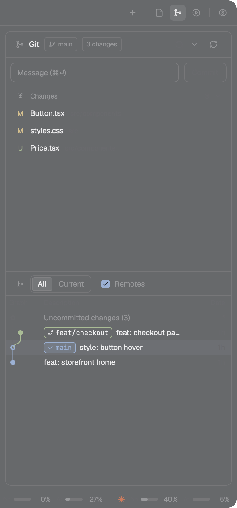

# Git · mod

Your daily git loop in one side panel, laid out like VS Code's Source Control view with the commit
graph kept underneath. Stage files or single hunks, commit, pull and push, switch branches, stash,
without leaving the terminal you are in.

[← The whole system](../README.md) · [Recipe](RECIPE.md)

<p>


</p>

## What it does

- **Changes and Staged groups.** Hover a file for discard (↺), stage (+) or unstage (−). Hover a
  group header for the same on every file. Click a header to fold it.
- **Commit** with ⌘⏎ in the message box. With nothing staged, it stages everything first.
- **Diffs with hunk buttons.** Click a file to see its diff in the bottom half, with
  Stage hunk / Discard hunk (or Unstage hunk) on each `@@` line. ↑/↓ step through files, Esc goes
  back to the graph.
- **Sync** in one button: fast-forward pull, then push. `↑2 ↓1` shows where you stand. With no
  upstream it becomes **Publish**. If the branch has diverged, it asks: rebase, merge or cancel.
- **Branches:** click the branch chip to filter, check out, or create one. A remote branch becomes a
  tracking branch.
- **Stash** from the menu (right-click the sync button), then apply, pop or drop any of the last 10.
- **Rebasing or merging?** Conflicted files show with `!`, and the header offers Continue and Abort.
- **A folder of repos** (Manygit): open a folder that holds several repositories and the panel
  lists them all with their sync state, plus **Fetch all**.
- **The graph:** every branch and remote as colored lanes, with tags. Drag the divider to resize,
  double-click it to reset.

## Safety

- **Every destructive action asks first:** discard (file, group or hunk), deleting untracked files,
  stash drop, mark resolved, abort. The confirm says when it can't be undone.
- **No surprise git.** A repo whose own config can launch a program (filter drivers, ssh, credential
  or askpass helpers, upload-pack and similar) is shown as *not read* until you open it.
- **Fetch** never prompts for credentials and never runs auto-gc.
- **If the branch moved** in a terminal since the panel drew, the action is refused rather than
  applied to the new HEAD.
- **No polling.** It reads git when the repo changes on disk, when you change focus, space or tab,
  and after its own actions.

## Install

```sh
./install.sh git
```

- **In the Crew layout,** it is the Git panel (⌘G).
- **In another layout,** add a block next to your other side panels:

  ```json
  { "id": "graph", "type": "block", "content": { "mod": "git" } }
  ```

It replaces Herdr's Changes panel and the original Git Graph panel. The settings of the original
(columns, depth, tags) carry over.

## Requirements

The Herdr desktop app and `git`. It works on remote machines too, except the live folder watch: there,
it refreshes on focus changes and after its own actions.

## Not built (yet)

Line-level staging, conflict resolution beyond Continue/Abort, amend, blame, file history,
commit search.

## Credits

Forked from [rabeeh-ta/herdr-git-graph](https://github.com/rabeeh-ta/herdr-git-graph) (MIT). Icons
from [Lucide](https://lucide.dev) (ISC).
