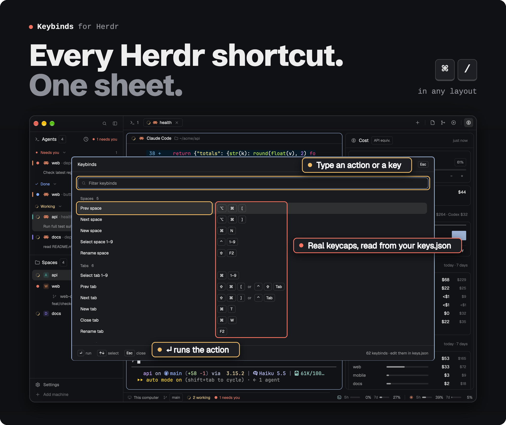

<div align="center">



<br>

**Every Herdr shortcut on one sheet, drawn as real keycaps.**<br>
Actions read as plain words, keys as keycaps, and typing filters by either. It reads your keys.json every time, so a key you just rebound shows at once.

```sh
./install.sh help-crew
```

<a href="https://github.com/Kai-Finds"></a>

<sub><a href="../README.md">All modules</a> · <a href="RECIPE.md">Recipe, to rebuild it with your agent</a></sub>

</div>

## What it does

- **One line per action**, grouped as Spaces, Tabs, Panes, Agents, Terminal, Layout, App and Mods.
  An action bound to two keys shows both, joined by `or`; the nine `⌘1` … `⌘9` bindings are one line, `⌘ 1–9`.
- **Each row:** the action in words (`Git panel`, not `tabs-crew.graph`), its keys as keycaps, and where
  it applies when that isn't everywhere (`in terminal`, `OhMyHerdr layout`). A chord's second stroke follows `then`.
- **↑↓ move, ↵ or a click runs the action** and closes the sheet. Typed sequences, the `1–9` lines and
  anything that closes, quits or resets only work from their key: a click on the sheet is never destructive.
- **Typing filters** on the action, its group, the raw key (`cmd-alt-[`) or the drawn key (`⌥⌘[`).
- **Always current.** It reads your `keys.json` every time it draws, so a key you just rebound shows at once.
- **Esc** or **⌘/** again closes it.

<a id="worth-it-or-skip-it"></a>


**✅ Worth it if**
- you rebind keys and forget where you put them
- you want one sheet you can filter by action or by key

**❌ Skip it if**
- you want Herdr's own help screen: this one takes over ⌘/ in every layout

## Install

```sh
./install.sh help-crew
```

It binds **⌘/** and **⌘⇧/** to the sheet, replacing Herdr's own help in any layout.

## Requirements

The Herdr desktop app.

---

<sub><b>Kai Finds</b> · Do more with AI · <a href="https://github.com/Kai-Finds">github.com/Kai-Finds</a> · <a href="https://kaifinds.sabaidev.la">kaifinds.sabaidev.la</a></sub>
