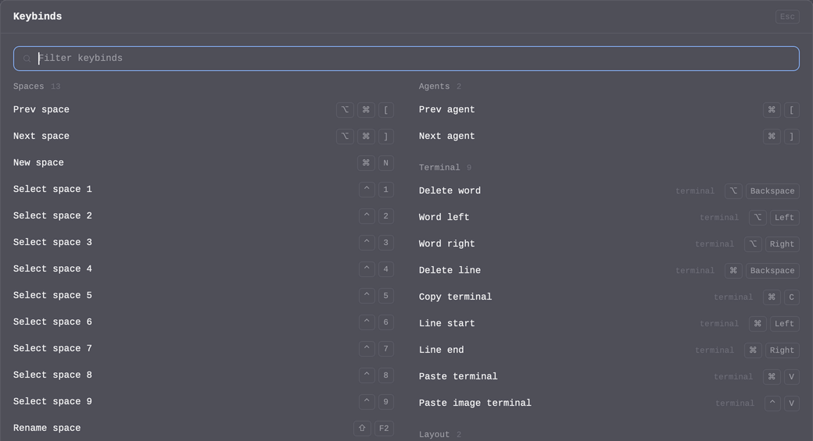

# Keybinds

Every Herdr keybind in one dialog, in two columns. Keys are drawn as keycaps (⌥ ⌘ [), actions read as
plain words ("Select space 1", "Delete word"), and typing filters the list. Opens on ⌘/.

## What you see

A centered 16:9 dialog (`kind: "dialog"`, 1040×585, `popover` background):

- **Header** (42px, hairline below): `Keybinds` at 13px on the left, an `Esc` keycap on the right.
- **Filter field** (32px, 8px radius, `accent` border, focused on open): a 13px search icon in `dim`,
  placeholder `Filter keybinds`, 12px text.
- **Two columns** (16px apart, the list scrolls past the bottom): the groups Spaces, Tabs, Panes,
  Agents, Terminal, Layout, Mods, App, in that order, cut where the row counts balance.
  - **Group heading** (24px): the name at 11px `muted` medium, its count at 10.5px `dim`.
  - **Row** (32px, 8px padding, 6px radius, `hover` background on hover): the action label at 12px
    `foreground`, truncated; the section at 10.5px `dim` when it isn't `global` (`terminal`,
    `layout:crew`); then the keys, one 20px keycap per symbol (`surface` fill, 1px `border`, 4px radius,
    10.5px `muted`), 4px apart. A second stroke follows the word `then`.
- Nothing matches: `No keybind matches` at 12px `dim`.

## How it behaves

- Typing filters on the label, the raw key (`cmd-alt-[`) or the drawn key (`⌥⌘[`).
- Esc closes it; ⌘/ again closes it too (`mod.open` toggles).
- Labels: `space.select:1` → `Select space 1`, `app.zoom_in` → `Zoom in`. Terminal `send:` bindings get
  names: `\u0017` Delete word, `\u0015` Delete line, `\u0001` Line start, `\u0005` Line end,
  `\u001bb` Word left, `\u001bf` Word right. Any other `send:` shows `Type "<text>"`.
- No agent statuses; it reads `keys()` on every render, so edits to `keys.json` show at once.

## Built from

- `mods/help-crew/mod.json`: `{"place":"none","title":"Keybinds","overlay":{"kind":"dialog","width":1040,"height":585}}`.
- `keys.json`: `cmd-/` and `cmd-shift-/` → `mod.open:help-crew` in `global` (they replace the shipped `app.help`).
- `main.js`: `View`, `div`, `svg` from gpui-kit; `v_flex`, `h_flex`, `InputState`, `Input` from gpui-base;
  `keys()`, `props()`, `closeOverlay`, `theme()`, `window()` from herdr. From the Crew `kit.js`:
  `dialog` (root + header), `field`, `keyLabel` (`cmd-shift-t` → `⇧⌘T`), `SIZE`, `ICON("search")`.

## Watch out

- `keyLabel` joins the modifiers into one string; split it back into caps on the symbols `⌃⌥⇧⌘`.
- Give the overlay a set height in `mod.json`, or a `flex_1` list collapses to 0.
- A filter `Set` must keep a binding in the first group whose pattern matches (`/./` last catches the rest).

## Done when

- `herdr-app check ~/.config/herdr-app/mods/help-crew` passes.
- `herdr-app do mod.open --name help-crew` shows two columns of groups with keycaps; `herdr-app shot` shows
  `⌥ ⌘ [` on "Prev space".
- Typing `tab` leaves only the Tabs group; typing `zzz` shows `No keybind matches`.
- The terminal group reads Word left / Delete word, never a `\u` escape.
