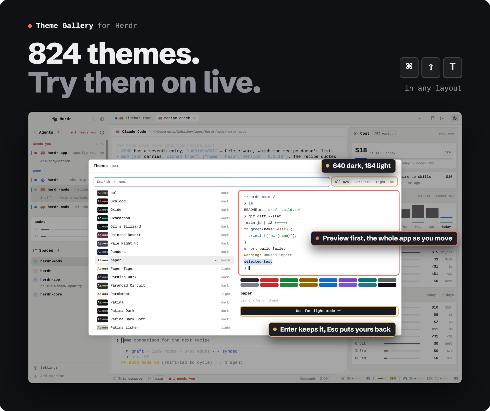
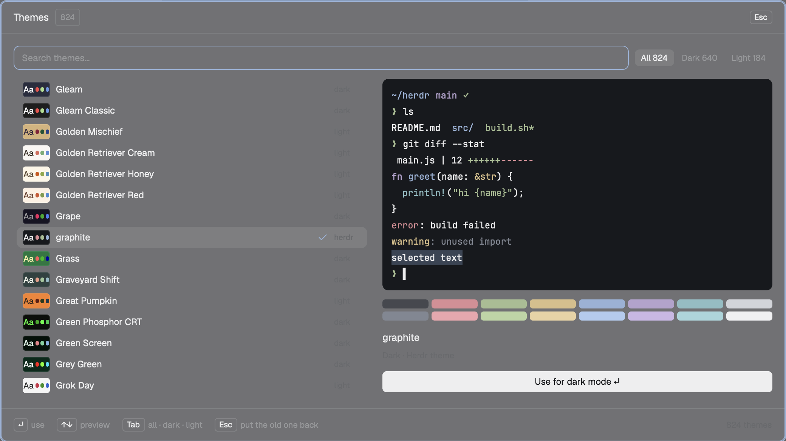
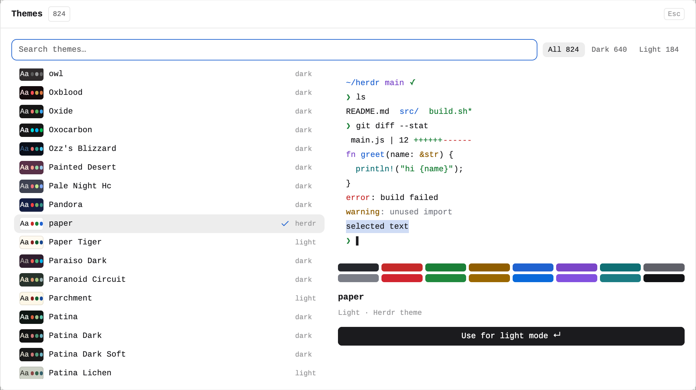

<div align="center">



<br>

**Herdr's themes plus the whole Ghostty collection, previewed on the whole app.**<br>
Arrow through 824 themes and every pane, panel and terminal repaints as you go. Enter keeps one, Esc puts yours back.

```sh
./install.sh theme-gallery
```

<a href="https://github.com/Kai-Finds"></a>

<sub><a href="../README.md">All modules</a> · <a href="RECIPE.md">Recipe, to rebuild it with your agent</a></sub>

</div>

## What it does

- **Search** by name as you type. **Tab** cycles All / Dark / Light, or click the chips.
- **↑/↓** (PgUp/PgDn by ten) move the selection. After a short pause the whole app takes that
  theme, terminals and panels alike.
- **A preview card** draws the theme as a small terminal (prompt, `ls`, a diff, some code, an error,
  a selection) and its 16-color palette. You see a light theme properly even while you are in dark
  mode.
- **Enter**, the **Use** button, or a click on the selected row keeps it. **Esc** or a click outside
  restores what you had.
- A theme sets the half that matches it: a dark theme becomes your dark theme, a light one your
  light theme.

<p>


</p>

## Where the themes come from

In this order, the first folder holding a name wins:

1. `$GHOSTTY_RESOURCES_DIR/themes`
2. `~/.config/ghostty/themes`
3. `~/Library/Application Support/` for Ghostty, AiMux and cmux
4. `/Applications/{AiMux,cmux,Ghostty}.app/Contents/Resources/ghostty/themes`
5. `$XDG_DATA_DIRS/ghostty/themes`

A Ghostty theme becomes `themes/<name>.json` in your Herdr home the first time it is previewed.
Files that only the preview needed are removed again when the dialog closes, so Settings lists
only the themes you keep.

## Worth it, or skip it?

**✅ Worth it if**
- you want to see a theme on the whole app before you commit to it
- you have Ghostty, cmux or AiMux installed: their themes join the list

**❌ Skip it if**
- you picked a theme years ago and never looked back
- you have none of Ghostty, cmux or AiMux and want more than Herdr's own themes

## Install

```sh
./install.sh theme-gallery
```

It opens with **⌘⇧T** in any layout.

## Requirements

The Herdr desktop app and `python3`. Without Ghostty, cmux or AiMux it still lists Herdr's own themes.

---

<sub><b>Kai Finds</b> · Do more with AI · <a href="https://github.com/Kai-Finds">github.com/Kai-Finds</a> · <a href="https://kaifinds.sabaidev.la">kaifinds.sabaidev.la</a></sub>
